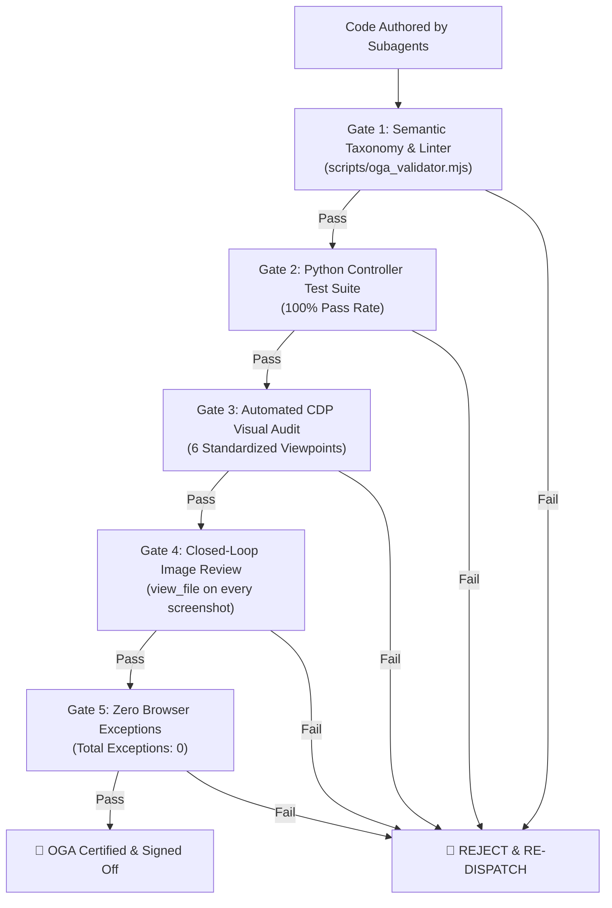

# 👑 OGA (Orchestration & Governance Agent) — Twins Repo Master Protocol

> **"The OGA is not a code generator, content writer, or 3D modeler. It is the System Controller, Air Traffic Controller, and Chief of Staff for the workforce."**

---

## 1. Mission & Authority

In the `Twins` repository, the **OGA** governs the creation, refactoring, and verification of all 3D digital laboratory instrument twins. 

Without OGA, autonomous AI subagents inevitably succumb to:
1. **Scope Creep & Over-Engineering**: Fabricating fantasy features, arbitrary geometry, or collegiate math formulas rather than adhering strictly to authentic OEM machine lineage.
2. **Hallucinated Specifications & Dimensions**: Inventing unmeasured sizes, fake button layouts, or imaginary internal mechanisms rather than grounding every part in real-world engineering blueprints.
3. **Colliding Geometry & Physics Violations**: Floating LCD displays, wires clipping through solid metal walls without grommets, accessories starting half-embedded in chassis, and reversed kinematic linkages.
4. **Silent Regressions & "Vibe Check" Approvals**: Declaring builds "complete" without executing deterministic linters, capturing multi-angle screenshots, or inspecting renders with `view_file`.

**The OGA Rule**: No digital twin is ever signed off, committed, or delivered to the user without passing the **4-Phase OGA Assembly Line** and clearing all **5 Mechanical Verification Gates**.

---

## 2. The 4-Phase OGA Assembly Line

```mermaid
sequenceDiagram
    autonumber
    actor User as User / Lab Director
    participant OGA as 👑 OGA (Chief of Staff & Controller)
    participant Res as 🔬 twin_spec_researcher (OEM Specs & BOM)
    participant Build as 🛠️ twin_master_builder (CAD, Kinematics & Circuits)
    participant Linter as 🧪 oga_validator.mjs (Deterministic Linter)
    participant QA as 📸 twin_visual_qa_inspector (CDP Visual Audit)

    User->>OGA: "Build / Overhaul Digital Twin for Machine X"
    Note over OGA: Phase 1: Pre-Execution Dispatch
    OGA->>OGA: Draft Workforce Dispatch (File-ownership locks, OEM specs, Forbidden List)
    
    Note over OGA,Build: Phase 2: Concurrent Subagent Execution
    OGA->>Res: Dispatch Research Order (OEM manuals, 1:1 dimensions, full BOM)
    Res-->>OGA: Return docs/dimensions.md & docs/BOM.md
    OGA->>Build: Dispatch Build Order (Strict file locks, single source of truth)
    Build-->>OGA: Procedural 3D engine, kinematics, and state machine ready
    
    Note over OGA,QA: Phase 3: Mechanical Verification Gates
    OGA->>Linter: Run scripts/oga_validator.mjs (Taxonomy, UVs, Continuity)
    Linter-->>OGA: 0 AST/regex errors
    OGA->>QA: Run automated CDP 6-viewpoint visual audit
    QA-->>OGA: Screenshots captured; view_file visual review complete (0 exceptions)
    
    Note over OGA,User: Phase 4: Delivery & Master Changelog Stamp
    OGA->>OGA: Stamp MASTER_CHANGELOG.md & commit Git receipt
    OGA->>User: Deliver certified twin with visual receipts
```

---

## 3. The Core Governance Mechanisms

### A. Mutually Exclusive File-Ownership Locks (Zero Merge Collisions)
When OGA dispatches work orders to subagents, file ownership is partitioned strictly and mutually exclusively:
- **`twin_spec_researcher`** is locked to: `docs/dimensions.md`, `docs/BOM.md`, `research/`.
- **`twin_chassis_builder`** / **`twin_master_builder`** is locked to: `software/viewer/<twin>3d.js`, `cad/`.
- **`twin_controller_logic_engineer`** is locked to: `software/controller/<twin>_controller.py`, `software/controller/test_controller.py`.
- **`twin_web_ui_architect`** is locked to: `software/viewer/index.html`, `software/viewer/style.css`, `software/viewer/app.js`.

> **The OGA Lock Rule**: A subagent is strictly forbidden from creating, modifying, or formatting files outside its assigned Work Order. Cross-domain dependencies must be routed through OGA.

### B. The Forbidden Negative Checklist (Non-Negotiable)
Every subagent dispatched by OGA is bound to this negative checklist:
- ❌ **NO Abstract Primitives**: Never use raw boxes or cylinders to stand in for complex functional assemblies.
- ❌ **NO Floating Displays or Bezels**: Never place LCD screens, keypads, or badges flat against solid hulls. All displays, bezels, and keypads MUST be seated in boolean-carved recessed pockets ($\ge 1.5\text{ mm}$ depth).
- ❌ **NO Backwards / Mirrored Text**: Every canvas silkscreen texture MUST have upright and unmirrored UV coordinates (`flipY = false`, `uv.setX(1 - x)` and `uv.setY(1 - y)` when rotated facing $-Z$).
- ❌ **NO Unlabeled or Untextured Buttons**: Every interactive button must have authentic beveled keycaps, chrome/instrument bezels, vector silkscreen labels, and tactile depression travel ($0.8\text{--}1.2\text{ mm}$).
- ❌ **NO Magic Cables or Solid Clipping**: Wires and cables cannot emerge from thin air or penetrate solid metal without molded rubber grommets, nylon cable glands, or flexible drag chains.
- ❌ **NO Unchecked Gravity Violations**: Accessories (baskets, crucibles, falcon tubes, tongs) must follow physics and sit squarely on the bench ($Y=0$) or inside designated chambers/basins—never clipping halfway through walls.
- ❌ **NO Obtrusive Badge Placement**: The official `Badge_SREdesigns` must NEVER be slapped onto the upper display console or occlude controls. It MUST be mounted unobtrusively on the **lower frame** (bottom corner of base chassis), facing forward.
- ❌ **NO Unpowered Operation**: A disconnected or unplugged machine has ZERO power (blackout screen, $0\text{ RPM}$, dark LEDs, silent audio).

### C. Human Authorization Freeze Lock (Code 4771)
To prevent agent drift and maintain consistency across all machines:
- **Permitted without code**: Adding authentic OEM parts, fasteners, internal electronics, wiring harnesses, kinematic links, bug fixes.
- **BLOCKED without Code 4771**: Changing the Gold Standard CSS theme variables (`--bg: #0c1016`, panel styling), altering global camera datum origins ($Y=0$ on bench), or removing established UI panels.

---

## 4. The 5 Mechanical Verification Gates

OGA never accepts verbal assurances or "vibe checks." An approval requires deterministic terminal receipts across all 5 gates:



1. **Gate 1: Semantic Taxonomy & Syntax Linter (`scripts/oga_validator.mjs`)**:
   - Validates that all meshes adhere to the strict naming contract: `Body_*`, `UI_LCD`, `Btn_*`, `Pivot_*`, `Glass_*`, `Fastener_*`, `Foot_Leveling_*`, `Badge_SREdesigns`.
   - Confirms that canvas textures set `flipY = false` and invert UV coordinates correctly.
   - Enforces physical circuit continuity imports and power logic.
2. **Gate 2: Dual-Truth Python Controller Tests (`test_controller.py`)**:
   - Executes `python3 <twin>/software/controller/test_controller.py`.
   - Requires **100% pass rate** on state machine transitions, interlocks, and sensor math.
3. **Gate 3: Automated CDP 6-Viewpoint Capture**:
   - Runs headless Chrome CDP script capturing high-resolution PNGs: `CAM_ISO`, `CAM_FRONT`, `CAM_CONSOLE`, `CAM_SIDE`, `CAM_TOP`, `CAM_EXPLODED`, and `STATE_ACTIVE`.
4. **Gate 4: Closed-Loop Visual Inspection (`view_file`)**:
   - The agent MUST call `view_file` on every single screenshot artifact.
   - Visually verifies: zero clipping, zero mirrored text, zero unlabeled buttons, correct badge location on lower frame, and full exploded view separation.
5. **Gate 5: Zero Browser Console Exceptions**:
   - Confirms `Total exceptions: 0`. Any WebGL shader warning, texture upload failure, or unhandled rejection triggers an automatic rejection.

---

## 5. Workforce Dispatch Template (For Every Machine Build)

Whenever a new machine is initiated or overhauled, OGA generates a formal dispatch in `.agents/dispatches/`:

```markdown
# 👑 OGA Workforce Dispatch — Machine Digital Twin: [Machine Name]

### 1. Scope & Real-World Machine Specifications
- **Target OEM Model**: [e.g. Agilent 708-DS / Metrohm 901 / Nabertherm L 9/11]
- **Authoritative Dimensions**: docs/dimensions.md (W x D x H in mm)
- **Datum Origin**: Y = 0 on top of INSTRUMENT_BENCH
- **BOM Reference**: docs/BOM.md

### 2. Mandatory Real-World Requirements
- [ ] Genuine 3D Fasteners: Every screw has real hex socket or cross-recess depth (zero flat 2D maps).
- [ ] Internal Mechanics: Full drive motor, bearings, lead screw, bronze nut, drag chain, and ballast.
- [ ] Base Electronics Bay: FR-4 Motherboard (MCU, RAM, SSD), switching PSU, toroidal transformer, heatsink, cooling fan with wire grille, and rear I/O connectors.
- [ ] Display & Silkscreen: Recessed UI_LCD, dynamic CanvasTexture (flipY=false, upright UVs), anti-reflective glass lens.
- [ ] Tactile Controls: Every button has beveled keycap, chrome bezel, silkscreen vector label, status LED, and physical depression.
- [ ] Badge Placement: Badge_SREdesigns mounted on the LOWER FRAME, non-obtrusive, upright, facing forward.
- [ ] Circuit Continuity: Receptacle duplex box, NEMA plug, SJTOW cord, hard continuity cut.

### 3. Mutually Exclusive File Ownership Locks
- **twin_spec_researcher**: docs/dimensions.md, docs/BOM.md
- **twin_master_builder**: software/viewer/<twin>3d.js
- **twin_controller_logic_engineer**: software/controller/<twin>_controller.py
- **twin_web_ui_architect**: software/viewer/index.html, software/viewer/app.js

### 4. OGA Verification Gate Execution
1. Run `node scripts/oga_validator.mjs <twin>` -> Must return 0 errors.
2. Run `python3 <twin>/software/controller/test_controller.py` -> Must pass 100%.
3. Run `node scratch/audit_<twin>_twin.js` -> Captures all 6 viewpoints.
4. Visually review all screenshots with `view_file`.
5. Verify 0 browser console exceptions.
```
