# SRE Laboratory Digital Twins

A premier open-access collection of **hyper-realistic, physically accurate 3D digital twins** representing scientific, analytical, and pharmaceutical laboratory instruments. 

Every instrument is procedurally engineered down to the smallest mechanical detail—including genuine 3D fasteners, unibody castings, internal electric motors, color-coded power wiring harnesses, physical sensors, 45° optical relay mirrors, microcontrollers, and dynamic high-DPI canvas displays.

---

### 🌐 Experience the Instruments Live in Your Browser

- 🚀 **[Launch Master Instrument Lab](https://srephoto.github.io/Twins/)** — Interactive multi-instrument portal and desk picker.
- 🎬 **[Watch Narrated Video Presentations & Internal Anatomy Guide](https://srephoto.github.io/Twins/presentations.html)** — High-definition operator workflows with synchronized voiceover tour and internal electromechanical tear-downs.

---

## 🔬 Featured Digital Twins & Multi-View Showcases

### 1. ERWEKA ZT 322 Tablet Disintegration Tester (USP &lang;701&rang;)

A high-precision dual-station pharmaceutical tablet disintegration tester built to USP &lang;701&rang; and Ph. Eur. 2.9.1 Apparatus A metrological standards. Features dual independent basket lift mechanisms, a 55.0 mm harmonic oscillation drive at 30 CPM, a 6.5 L clear acrylic water bath with a 1000 W PT100 immersion circulator, dual 1000 mL borosilicate glass beakers, and USP 6-tube baskets with 10-mesh 316L stainless steel bottom screens.

| 3D Isometric Overview | Active 30 CPM Oscillation & Water Bath |
| :---: | :---: |
| 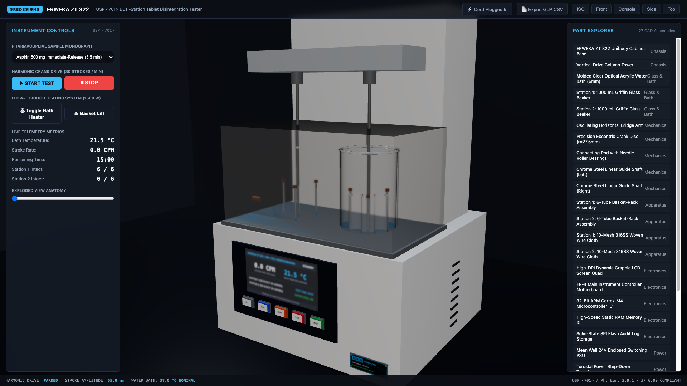 | 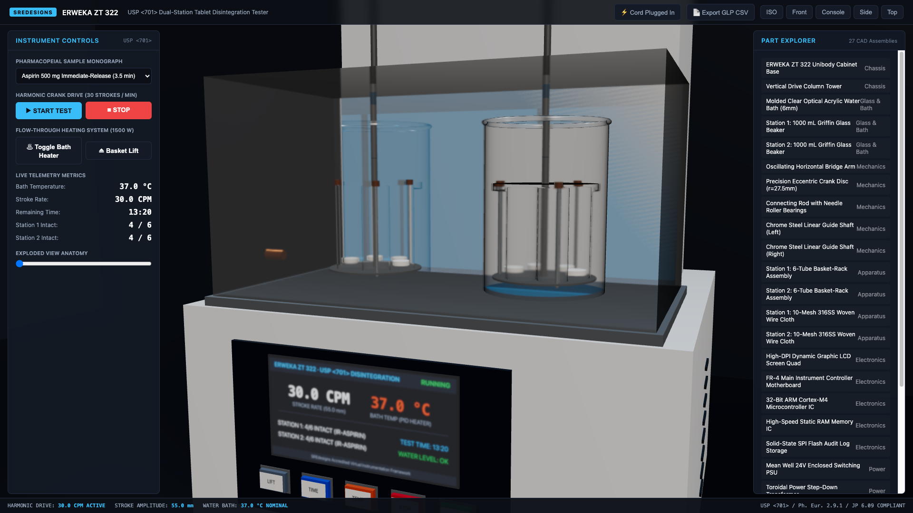 |
| *1:1 cast chassis, bench duplex receptacle, and dual beakers* | *USP &lang;701&rang; sinusoidal stroke motion and glowing heater* |

| Exploded Kinematics Assembly | 7A. Power Supply & 3D Wiring Harnesses |
| :---: | :---: |
| 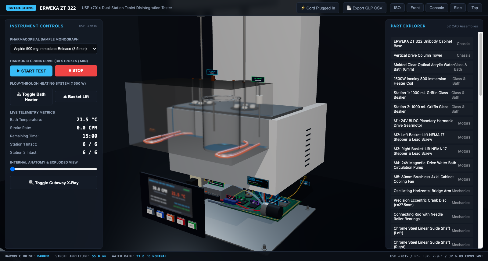 | 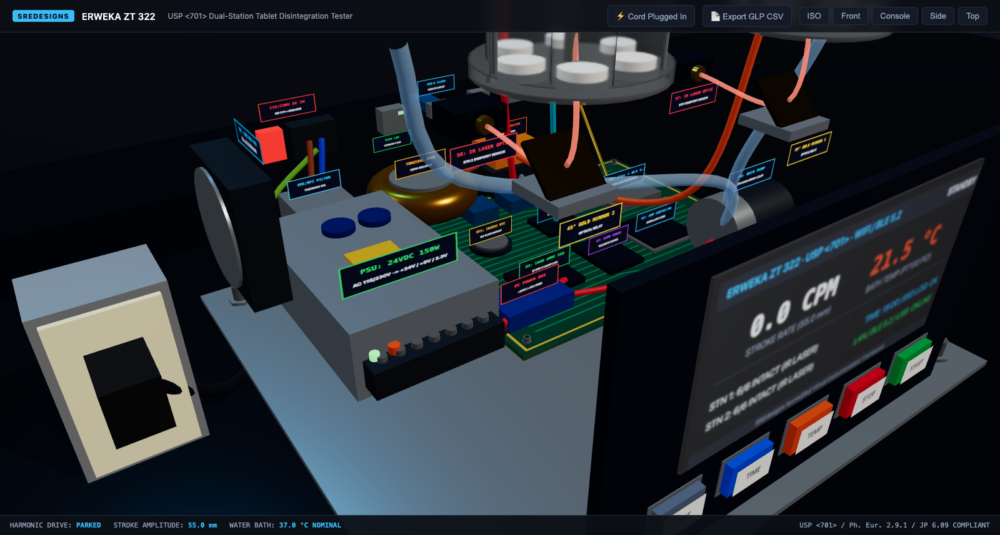 |
| *Vertical kinematic separation revealing internal subassemblies* | *AC mains inlet, 180VA toroidal transformer, PSU, and color-coded harnesses* |

| 7B. 5-Motor Mechanical Actuator Suite | 7C. Sensors & 45° Gold Optical Relay Mirrors |
| :---: | :---: |
| 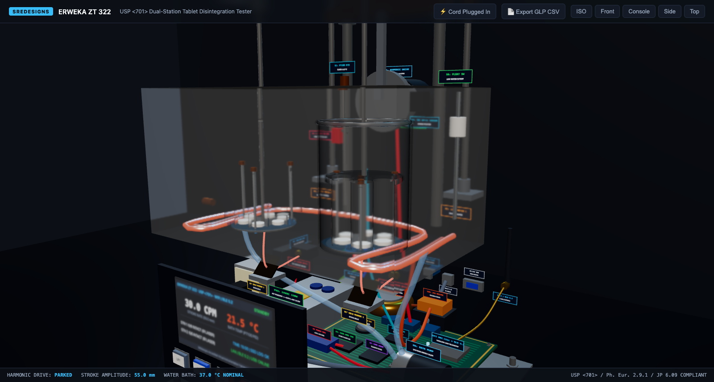 | 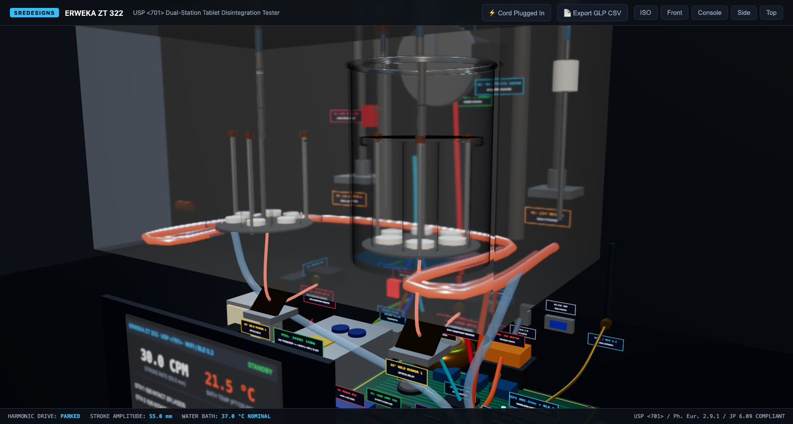 |
| *M1 drive stepper, M2/M3 lift motors, M4 pump, and M5 blower* | *PT100 probes, Hall sensors, optical encoders, and 45° gold mirrors* |

- 🔗 **[Launch ERWEKA ZT 322 3D Twin](https://srephoto.github.io/Twins/disintegration_tester_twin/software/viewer/index.html)**
- 🎬 **[Launch In-App Guided Tour](https://srephoto.github.io/Twins/disintegration_tester_twin/software/viewer/index.html?tour=1)**

---

### 2. Eppendorf MICRO 5424-R High-Speed Refrigerated Microcentrifuge

An ultra-quiet, 15,000 RPM (21,130 &times; g) refrigerated microcentrifuge designed for molecular biology and biochemical fraction separations. Models aerodynamic rotor drag, motorized safety lid latch kinematics, refrigeration compressor loops, dynamic sample pellet separation layers, and tactile membrane push buttons.

| Isometric Lab View | Exploded Motor & Rotor Assembly |
| :---: | :---: |
| 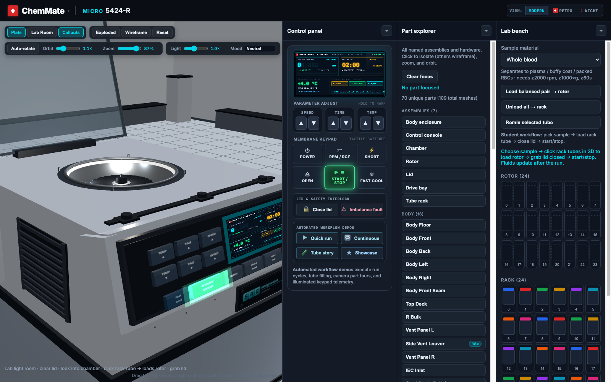 | 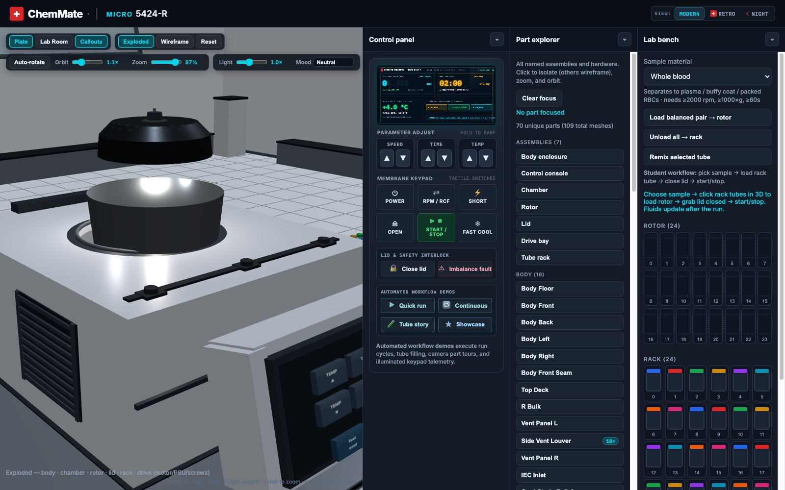 |
| *Die-cast enclosure, dynamic LCD, and QuickLock rotor lid* | *Induction drive motor, cast iron ballast, vibration dampers, and PCB* |

- 🔗 **[Launch MICRO 5424-R 3D Twin](https://srephoto.github.io/Twins/centrifuge_twin/software/viewer/index.html)**

---

### 3. METTLER TOLEDO XSE204 Precision Analytical Balance

A 0.1 mg four-decimal-place analytical balance with motorized glass draft shield doors, SmartGrid weighing pan, internal motorized calibration weights, and electro-magnetic force restoration (EMFR) voice coil transducer physics.

| Isometric View & Draft Chamber |
| :---: |
| 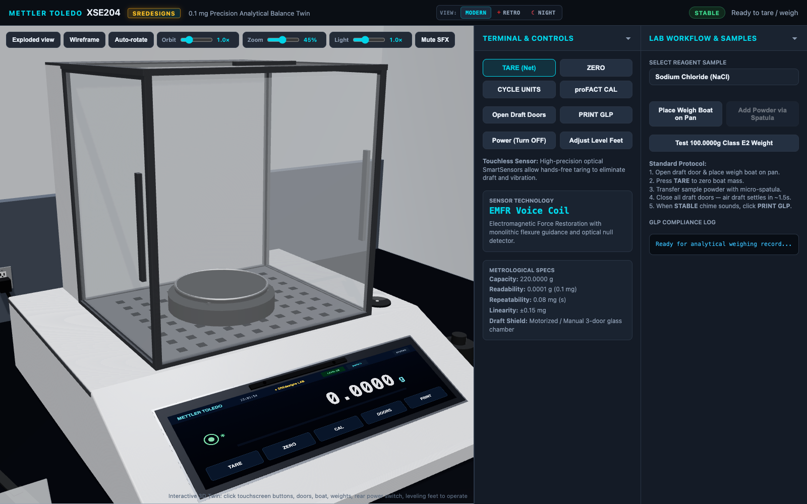 |
| *Motorized 3-door glass draft shield, spirit bubble level, and EMFR weighing cell* |

- 🔗 **[Launch METTLER XSE204 3D Twin](https://srephoto.github.io/Twins/balance_twin/software/viewer/index.html)**

---

### 4. BÜCHI Rotavapor R-300 Rotary Evaporator

An industrial-standard rotary evaporator engineered for gentle, vacuum-assisted solvent evaporation and distillation. Features a motorized vertical lift mast with Acme lead screw, a 45° angled drive head with quick-release Combi-Clip, a PTFE vacuum seal, a B-300 water/oil heating bath, and a double-spiral borosilicate glass condenser with receiving flask.

| Isometric Distillation View |
| :---: |
| 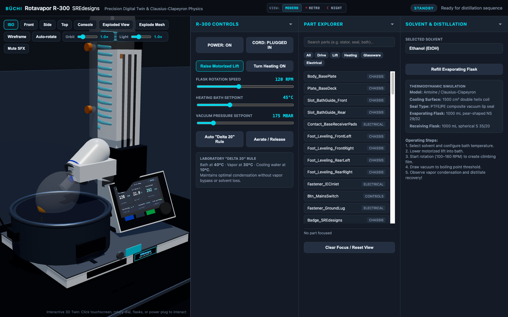 |
| *Heating bath, vapor duct rotation drive, condenser spiral, and motorized lift* |

- 🔗 **[Launch BÜCHI R-300 3D Twin](https://srephoto.github.io/Twins/rotovap_twin/software/viewer/index.html)**

---

### 5. Parr 4560 High-Pressure Stirred Mini-Reactor

A 300 mL 316L stainless steel high-pressure mini-reactor rated for 200 bar MAWP and 350°C. Features a 2-piece drop-band split-ring closure clamp, a fixed head plate with cooling loop, an electric clamshell heating mantle with dynamic blackbody thermal glow, a magnetic stirrer drive, and an analog Bourdon-tube pressure dial.

| Isometric Overview | Exploded Reaction Chamber & Headplate |
| :---: | :---: |
|  | 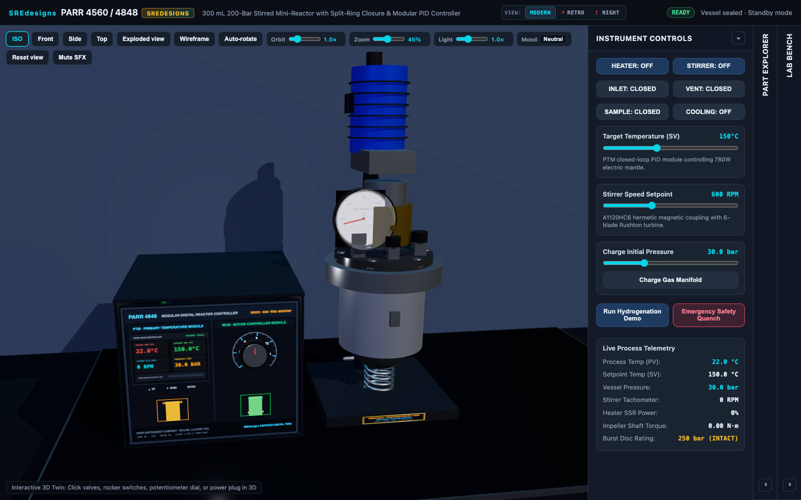 |
| *A-frame mast, clamshell mantle, and Parr 4848 controller* | *Split-ring clamps, turbine impeller, dip tube, and cooling coils* |

- 🔗 **[Launch Parr 4560 3D Twin](https://srephoto.github.io/Twins/high_pressure_reactor_twin/software/viewer/index.html)**

---

### 6. STIR-HEAT 500-D Hotplate & UNI-9000 Inert Atmosphere Glove Box

| STIR-HEAT 500-D Digital Hotplate Stirrer | UNI-9000 Pro Inert Atmosphere Glove Box |
| :---: | :---: |
| 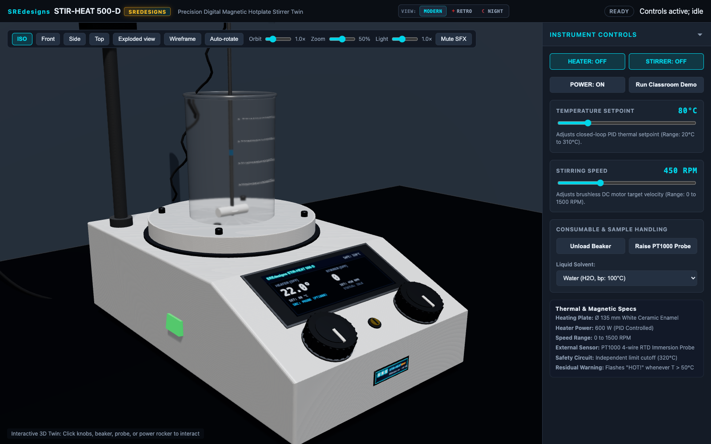 | 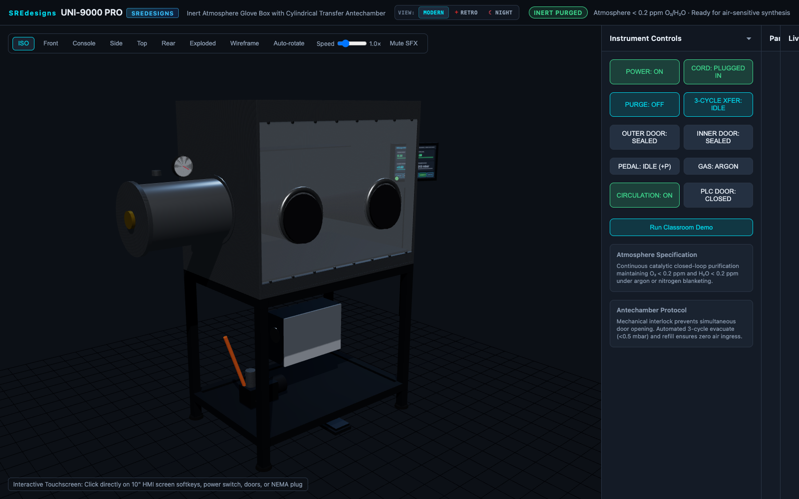 |
| *Ceramic plate, PT1000 ATC probe, and fluid vortex dynamics* | *Butyl sleeves, 3-cycle antechamber, and PLC touchscreen* |
| [Launch Hotplate Twin](https://srephoto.github.io/Twins/hotplate_twin/software/viewer/index.html) | [Launch Glove Box Twin](https://srephoto.github.io/Twins/glove_box_twin/software/viewer/index.html) |

---

## ⚡ What Makes These Digital Twins Unique

1. **Exhaustive Procedural CAD Detail**: Zero abstract low-poly primitives or flat normal-mapped decals. Every single screw (DIN 912 hex sockets and cross recesses), washer, gasket, bracket, and connector is genuine 3D physical geometry.
2. **Physical Circuit Continuity**: Real laboratory equipment does not operate without electricity. Every machine models a benchtop duplex receptacle box (`Power_Receptacle_Duplex`), a molded NEMA 5-15P plug, and an SJTOW cord. Unplugging the cord instantly cuts power: screens black out, motors coast to 0 RPM, and heaters cool down.
3. **Internal Electromechanical Anatomy**: Outer panels can be hidden or vertically exploded to reveal switching power supplies (`Mean Well`), toroidal transformers, solid-state relays (SSR) on finned heatsinks, color-coded 3D wiring harnesses, internal drive motors, precision gearboxes, PT100 sensors, and optical relay mirrors.
4. **Data, Wireless & Storage Architecture**: FR-4 motherboards feature ARM Cortex-M4 microcontrollers, SDRAM, non-volatile eMMC SSD modules, 24-bit ADCs, battery-backed RTCs, shielded Wi-Fi & Bluetooth BLE 5.2 modules with 2.4 GHz dipole antennas, and physical communication ports (`RS-232 DB9`, `USB-B`, `USB-A Flash Host`, `RJ45 Ethernet LAN`).
5. **Dual-Truth Physics**: State machines accurately model closed-loop PID thermodynamics, Gay-Lussac gas expansion, Stokes sedimentation settling, Nernstian electrochemistry, and USP &lang;701&rang; tablet disintegration kinetics.
6. **Dynamic High-DPI Displays**: Dedicated LCD quads render real-time Canvas textures with upright UV mapping, unpowered blackout states, and calibrated silkscreen typography.
7. **Synthesized Web Audio Acoustics**: Procedural audio synthesizers generate variable-frequency motor whining, switch snaps, microswitch detents, relay contactor thuds, and completion chimes.

---

## 📋 Complete Instrument Fleet Catalogue

| # | Instrument | Model / Class | Metrology & Key Capabilities | Live 3D Twin |
| :-: | :--- | :--- | :--- | :-: |
| **01** | **Hotplate Stirrer** | STIR-HEAT 500-D | Ceramic plate (310°C), magnetic vortex dynamics, PT1000 ATC | [Launch ➔](https://srephoto.github.io/Twins/hotplate_twin/software/viewer/index.html) |
| **02** | **Analytical Balance** | METTLER XSE204 | 0.1 mg precision, EMFR weighing cell, motorized draft doors | [Launch ➔](https://srephoto.github.io/Twins/balance_twin/software/viewer/index.html) |
| **03** | **Microcentrifuge** | MICRO 5424-R | 15,000 RPM (21,130 &times; g), QuickLock rotor, sample pellet layers | [Launch ➔](https://srephoto.github.io/Twins/centrifuge_twin/software/viewer/index.html) |
| **04** | **Rotary Evaporator** | BÜCHI R-300 | Motorized lift, Combi-Clip, B-300 bath, double-spiral condenser | [Launch ➔](https://srephoto.github.io/Twins/rotovap_twin/software/viewer/index.html) |
| **05** | **UV-Vis Spectrophotometer** | Shimadzu UV-1900i | Czerny-Turner monochromator, 6-cell carousel, Beer-Lambert | [Launch ➔](https://srephoto.github.io/Twins/spectrophotometer_twin/software/viewer/index.html) |
| **06** | **Benchtop pH Meter** | SRE PH-7000 Pro | 0.001 pH accuracy, ATC probe, Nernstian electrochemistry | [Launch ➔](https://srephoto.github.io/Twins/ph_meter_twin/software/viewer/index.html) |
| **07** | **Muffle Furnace** | THERMO-1200 | 1200°C chamber, 4-bar parallel lift door, blackbody thermal glow | [Launch ➔](https://srephoto.github.io/Twins/muffle_furnace_twin/software/viewer/index.html) |
| **08** | **Diaphragm Vacuum Pump** | KNF Laboport N820 | 100% oil-free, dual PTFE heads, 6 mbar ultimate vacuum | [Launch ➔](https://srephoto.github.io/Twins/vacuum_pump_twin/software/viewer/index.html) |
| **09** | **Inert Atmosphere Glove Box** | SRE UNI-9000 Pro | &lt;1 ppm O₂/H₂O, 3-cycle antechamber purge, butyl glove ports | [Launch ➔](https://srephoto.github.io/Twins/glove_box_twin/software/viewer/index.html) |
| **10** | **High-Pressure Stirred Reactor** | Parr 4560 / 4848 | 200 bar MAWP, magnetic stirrer drive, clamshell mantle | [Launch ➔](https://srephoto.github.io/Twins/high_pressure_reactor_twin/software/viewer/index.html) |
| **11** | **Vortex Mixer** | Vortex-Genie 2 Pro | 2400 RPM eccentric orbital motion, dynamic liquid vortex funnel | [Launch ➔](https://srephoto.github.io/Twins/vortex_mixer_twin/software/viewer/index.html) |
| **12** | **Ultrasonic Cleaner** | Branson CPX Series | 40 kHz cavitation transducer array, heated degassing cycles | [Launch ➔](https://srephoto.github.io/Twins/ultrasonic_cleaner_twin/software/viewer/index.html) |
| **13** | **Karl Fischer Titrator** | Metrohm 901 Titrando | Volumetric/coulometric moisture titration, dynamic buret dosing | [Launch ➔](https://srephoto.github.io/Twins/karl_fischer_twin/software/viewer/index.html) |
| **14** | **Laboratory Freeze Dryer** | Labconco FreeZone | -50°C collector, condenser coil sublimation, Pirani vacuum gauge | [Launch ➔](https://srephoto.github.io/Twins/freeze_dryer_twin/software/viewer/index.html) |
| **15** | **Tablet Dissolution Tester** | USP Apparatus 2 | 6-station paddle spindle drive, 37°C thermostatic circulation | [Launch ➔](https://srephoto.github.io/Twins/dissolution_tester_twin/software/viewer/index.html) |
| **16** | **F1 2026 Brake Corner** | FIA Formula 1 | Carbon-carbon rotor, monobloc caliper, brake-by-wire MGU-K | [Launch ➔](https://srephoto.github.io/Twins/f1_2026_brake_twin/software/viewer/index.html) |
| **17** | **Tablet Disintegration Tester** | ERWEKA ZT 322 | Dual-station USP &lang;701&rang;, 55mm harmonic drive, 30 CPM, PT100 bath | [Launch ➔](https://srephoto.github.io/Twins/disintegration_tester_twin/software/viewer/index.html) |

---

## 🎬 Guided Walkthroughs & Video Presentations

For interactive audio-visual tours and full internal engineering tear-downs with voiceover narration, visit the **[Video Presentations & Internal Working Anatomy Hub](https://srephoto.github.io/Twins/presentations.html)**.
