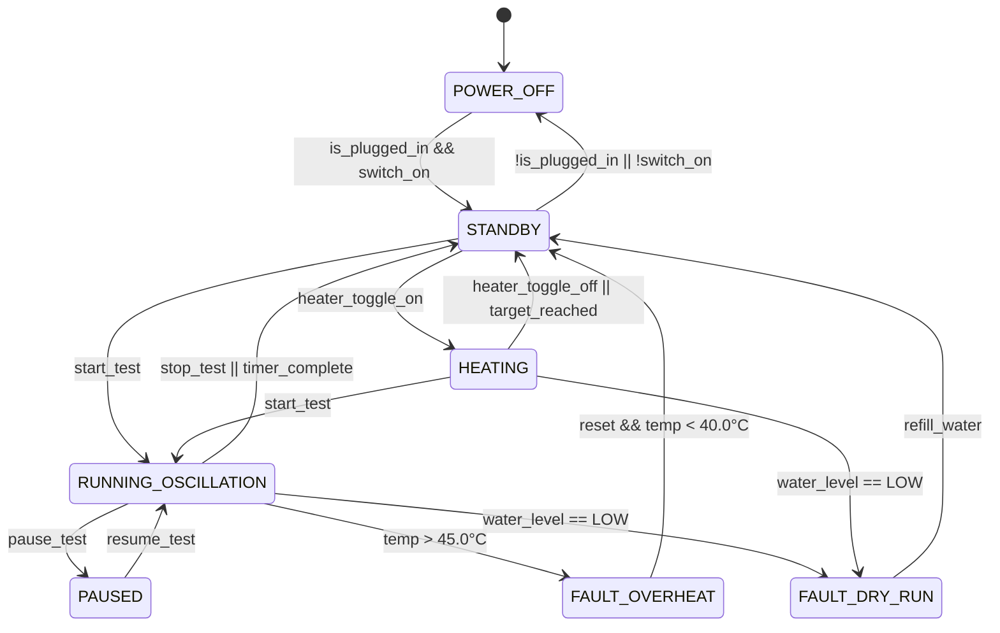

# ERWEKA ZT 322 Tablet Disintegration Tester: Control Specification & Physical Formulas

## 1. State Machine Architecture

The digital twin runtime is governed by an explicit finite-state machine (FSM) mirroring real laboratory instrumentation firmware:

---

## 2. Mathematical Kinematic Models

### 2.1 Pure Sinusoidal Harmonic Oscillation
The vertical stroke is driven by an eccentric rotary disc coupled to a linear crosshead slider.
For crank radius $r = 27.5\text{ mm}$ and connecting rod length $L = 120.0\text{ mm}$:

$$\theta(t) = 2\pi \cdot \left(\frac{\text{RPM}}{60}\right) \cdot t$$

The exact kinematic displacement of the basket carrier from its mean rest height $y_0 = 560.0\text{ mm}$ is:

$$y(t) = y_0 + r \cdot \cos(\theta(t)) + \sqrt{L^2 - r^2 \cdot \sin^2(\theta(t))} - \sqrt{L^2}$$

Since $r/L = 27.5 / 120 \approx 0.229$, harmonic distortion is negligible, conforming closely to the compendial pure sine wave:

$$y(t) \approx y_0 + A \cdot \sin(2\pi \cdot f \cdot t)$$
where:
- $A = 27.5\text{ mm}$ (peak-to-peak stroke $2A = 55.0 \pm 2.0\text{ mm}$)
- $f = 0.50\text{ Hz}$ ($30.0\text{ strokes/min}$)
- Velocity profile: $v(t) = 2\pi f A \cdot \cos(2\pi f t)$, with peak fluid entry velocity $v_{\max} = 86.4\text{ mm/s}$.

---

## 3. Thermal Dynamics & Flow-Through Heating Loop

The water bath temperature $T(t)$ is modeled via an active first-order energy balance with ambient convective loss:

$$m_{\text{water}} \cdot C_p \cdot \frac{dT}{dt} = P_{\text{heater}} \cdot \eta(t) - U \cdot A_{\text{bath}} \cdot (T(t) - T_{\text{amb}})$$

where:
- $m_{\text{water}} = 6.0\text{ kg}$ (approx. $6.0\text{ L}$ in bath tank)
- $C_p = 4184\text{ J}/(\text{kg}\cdot\text{K})$ (specific heat of water)
- $P_{\text{heater}} = 1500\text{ W}$ (rated Incoloy flow-through heating power)
- $\eta(t) \in [0.0, 1.0]$: PID duty cycle from temperature controller
- $U \cdot A_{\text{bath}} \approx 8.5\text{ W/K}$: Overall heat loss coefficient to ambient air
- $T_{\text{amb}} = 21.5^\circ\text{C}$ (standard lab ambient)

### PID Controller Formulation
The heater duty cycle is computed every time step:
$$\eta(t) = \text{clamp}\left( K_p \cdot e(t) + K_i \int e(t) dt + K_d \frac{de(t)}{dt}, 0.0, 1.0 \right)$$
where $e(t) = T_{\text{target}} - T(t)$, with $K_p = 0.35$, $K_i = 0.008$, and $K_d = 1.2$.

---

## 4. Disintegration Kinetic Models (USP <701>)

### 4.1 Immediate-Release Dosage Form (e.g. Aspirin / Paracetamol)
Rapid porous matrix hydration and mechanical erosion:
$$M_{\text{tablet}}(t) = M_0 \cdot \max\left(0, 1 - \left(\frac{t}{t_{\text{disint}}}\right)^\alpha\right)$$
- $M_0 = 500\text{ mg}$
- $t_{\text{disint}} \approx 210\text{ s}$ ($3.5\text{ min}$)
- $\alpha \approx 1.4$ (accelerating erosion as tablet crumbles through 10-mesh screen)
- Complete disintegration criterion: All particles pass through the 10-mesh screen ($M_{\text{tablet}} = 0$).

### 4.2 Delayed-Release / Enteric-Coated Dosage Form
Biphasic acid-resistant polymer film:
- **Phase 1 (Simulated Gastric Fluid, $0.1\text{ N HCl}, \text{pH } 1.2$ for $120\text{ min}$)**:
  - Polymer coating (e.g. cellulose acetate phthalate / Eudragit L100) insoluble below pH 5.5.
  - Tablet remains intact: $M(t) = M_0$, zero disintegration ($0\%$ through screen).
- **Phase 2 (Simulated Intestinal Fluid, Phosphate Buffer, $\text{pH } 6.8$)**:
  - Coating dissolves in $2\text{--}4\text{ min}$; core tablet disintegrates rapidly within $15\text{ min}$.

---

## 5. GLP Audit Trail & Telemetry Data Schema

Every second during an active run, the controller logs an analytical record for GLP compliance:
- `timestamp`: ISO-8601 UTC string
- `stroke_count`: Cumulative integer cycle count
- `stroke_frequency_cpm`: Measured strokes/min ($29.0\text{--}31.0$)
- `bath_temp_celsius`: Measured RTD temperature ($\pm 0.1^\circ\text{C}$)
- `station_1_intact_count`: Remaining intact tablets in Station 1 ($0\text{--}6$)
- `station_2_intact_count`: Remaining intact tablets in Station 2 ($0\text{--}6$)
- `heater_state`: Boolean on/off status
- `interlocks_ok`: Boolean composite safety status
