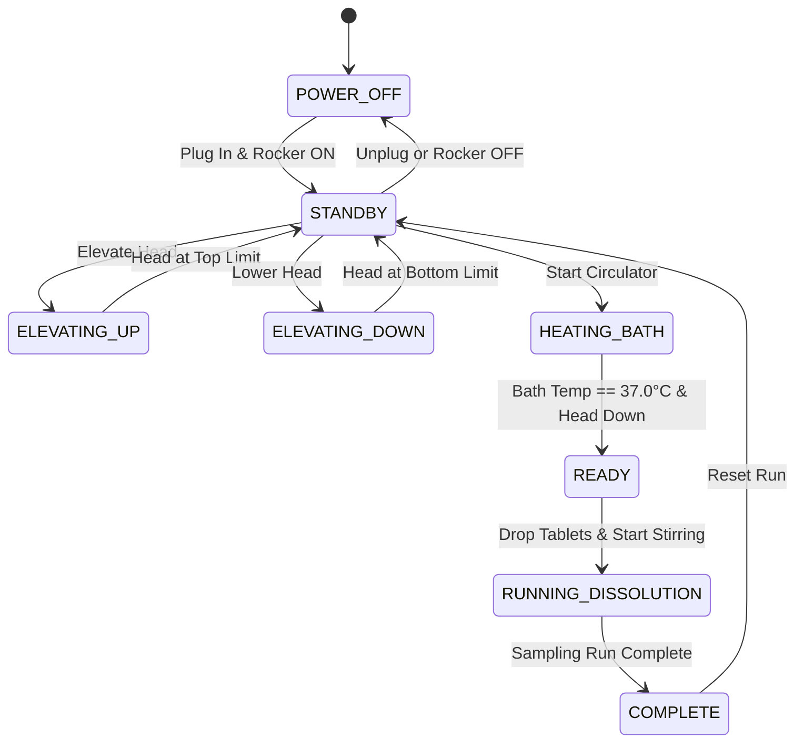

# Control Specification & Noyes-Whitney ODE State Machine: Agilent 708-DS

## 1. Thermodynamic & Kinematic State Machine

The Agilent 708-DS Dissolution Apparatus digital twin models the automated physical kinematics, temperature regulation, and Noyes-Whitney dissolution kinetics.

---

## 2. Operating States & Physics Simulation

### 2.1 `POWER_OFF` (Unpowered Blackout)
- **Condition**: `!isPluggedIn || !powerSwitchOn` (DIAG-014).
- **Outputs**: Elevator motor, spindle servo motor, bath heater, and circulation pump all de-energized (0 W).
- **Touchscreen**: Blackout with "NO AC POWER CONTINUITY".

### 2.2 `ELEVATING_UP` & `ELEVATING_DOWN` (Vertical Drive Kinematics)
- **Kinematics**:
  $$Y_{head}(t) = Y_{base} + v_{elev} \cdot t$$
  where $v_{elev} = 15.0\text{ mm/s}$, stroke $= 311.0\text{ mm}$ (approx $20.7\text{ s}$ full stroke, animated with smooth S-curve acceleration).
- **Safety Interlock**: Spindle motor is electrically locked out whenever $Y_{head} > 5.0\text{ mm}$ (prevents rotating blades outside of vessels).

### 2.3 `HEATING_BATH` (Water Bath Thermoregulation)
- **Thermal Model**:
  $$\frac{dT_{bath}}{dt} = \frac{\dot{Q}_{heater} - U \cdot A_{bath} (T_{bath} - T_{room})}{m_{water} \cdot c_p}$$
  where $\dot{Q}_{heater} = 1150\text{ W}$, $m_{water} = 28.0\text{ kg}$, $c_p = 4184\text{ J}/(\text{kg}\cdot\text{K})$.
  - Simulates fast-forwarded heating curve: ambient ($21.5^\circ\text{C}$) $\to 37.0^\circ\text{C}$ ($\pm 0.5^\circ\text{C}$ USP compliance).

### 2.4 `RUNNING_DISSOLUTION` (Noyes-Whitney Dissolution Kinetics)
- **Trigger**: User drops tablets and starts spindle motor.
- **Physics**:
  8 simultaneous numerical ODE integrations (one for each vessel position):
  $$\frac{dC_i}{dt} = \frac{D \cdot A_i(t)}{V \cdot h(\text{RPM})} \left(C_s - C_i(t)\right)$$
  - Tablet surface area shrinkage:
    $$A_i(t) = A_0 \left(1 - \frac{M_{dissolved, i}(t)}{M_{tablet}}\right)^{2/3}$$
  - Stirring boundary layer thickness $h(\text{RPM}) = h_0 \left(\frac{50}{\text{RPM}}\right)^{0.6}$.
  - Dissolution percent:
    $$\% \text{ Dissolved}_i(t) = \frac{C_i(t) \cdot V}{M_{tablet}} \times 100\%$$
- **Real-Time Dynamic Visuals**:
  - Spindles rotate at set RPM with realistic hydrodynamic vortex meniscus depth:
    $$\Delta h_{vortex} = \frac{\omega^2 R^2}{2g}$$
  - Tablet 3D mesh at bottom of vessel shrinks in diameter and height as mass dissolves!
  - Dissolution medium develops localized swirling tint representing dissolved drug concentration!

---

## 3. Safety Alarms & Interlock Matrix

| Interlock ID | Condition | Action | UI Annunciation |
| :--- | :--- | :--- | :--- |
| `INTLK_CONTINUITY` | NEMA plug removed or switch OFF | Immediate blackout & motor stop | Screen: "NO AC POWER CONTINUITY" |
| `INTLK_HEAD_ELEV` | Spindle start commanded while head is elevated | Inhibit spindle motor start | Screen: "HEAD ELEVATED - LOWER HEAD TO STIR" |
| `ALARM_BATH_TEMP` | Bath temperature $< 36.5^\circ\text{C}$ or $> 37.5^\circ\text{C}$ during test | Flag USP non-compliance | Screen: "BATH TEMP OUT OF USP SPEC (37.0±0.5°C)" |
| `ALARM_SPINDLE_WOBBLE`| Simulated spindle runout $> 1.0\text{ mm}$ | Mechanical warning flag | Screen: "SPINDLE RUNOUT WARNING" |
