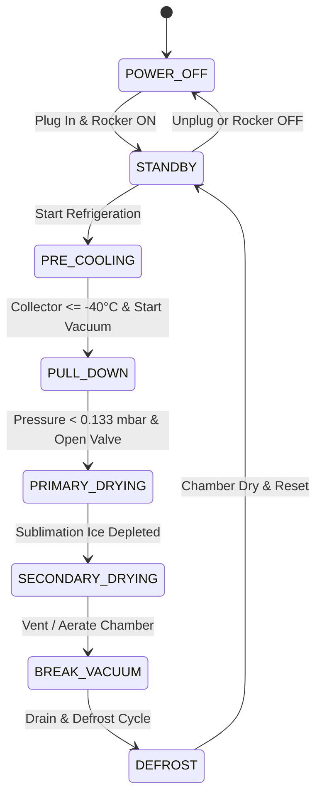

# Control Specification & Thermodynamic State Machine: Labconco FreeZone 4.5L

## 1. Thermodynamic State Machine Architecture

The FreeZone 4.5L (-84°C) digital twin executes a dual-truth thermodynamic model mirroring the Labconco Lyo-Works OS operating sequence.

---

## 2. Operating States & Transition Logic

### 2.1 `POWER_OFF` (Unpowered Blackout)
- **Condition**: `!isPluggedIn || !powerSwitchOn` (DIAG-014).
- **Physical Outputs**:
  - Compressors 1 & 2: `OFF` (0 W).
  - Vacuum Pump: `OFF` (0 W).
  - Vacuum Solenoid Valve: `DE-ENERGIZED` (Vented/Isolated).
  - Touchscreen Display `UI_LCD`: Blackout with unpowered text message.
  - Audio SFX: Silenced.

### 2.2 `STANDBY` (System Ready)
- **Condition**: `isPluggedIn && powerSwitchOn`.
- **Telemetry**:
  - Collector Temp $T_{cond}$: Ambient ($+21.5^\circ\text{C}$).
  - Chamber Vacuum $P_{vac}$: Atmospheric ($1013.25\text{ mbar}$).
  - Compressor Stage 1: `STANDBY`.
  - Compressor Stage 2: `STANDBY`.
  - Vacuum Pump: `OFF`.

### 2.3 `PRE_COOLING` (Cascade Refrigeration Pull-Down)
- **Trigger**: User presses `Btn_Refrig` or initiates Auto Run.
- **Thermodynamic Model**:
  - **Stage 1 Compressor (R404A)** starts:
    $$\frac{dT_{stage1}}{dt} = -k_{cool1} (T_{stage1} - T_{evap1}), \quad T_{evap1} = -38.0^\circ\text{C}$$
  - When $T_{stage1} \le -25.0^\circ\text{C}$, **Stage 2 Compressor (R508B)** starts:
    $$\frac{dT_{cond}}{dt} = -k_{cool2} (T_{cond} - T_{target}), \quad T_{target} = -84.0^\circ\text{C}$$
  - Pull-down duration: Model simulates fast-forwarded cooling curve (ambient $\to -84^\circ\text{C}$ in realistic animated rate).

### 2.4 `PULL_DOWN` (Vacuum Evacuation)
- **Safety Interlock**: Vacuum pump will NOT start unless collector temperature $T_{cond} \le -40.0^\circ\text{C}$ (prevents damaging solvent/water vapor backstreaming into pump oil).
- **Trigger**: User presses `Btn_Vacuum` or Auto Sequence reaches ready condition.
- **Evacuation Model**:
  $$P_{vac}(t) = P_{base} + (P_{atm} - P_{base}) e^{- \frac{S_{eff}}{V_{ch}} t}$$
  where $S_{eff} = 5.0\text{ m}^3/\text{h}$ (Edwards RV5 effective pumping speed) and $V_{ch} \approx 32\text{ L}$ (Chamber + Drum).
  - System pulls down from $1013\text{ mbar} \to < 0.133\text{ mbar}$ ($100\text{ mTorr}$). Target ultimate vacuum: $0.020\text{ mbar}$ ($15\text{ mTorr}$).

### 2.5 `PRIMARY_DRYING` (Sublimation & Frost Accumulation)
- **Trigger**: At least one Quick-Seal valve rotated to `VACUUM` ($0^\circ$).
- **Physics**:
  - Frozen sample cake ($T_{cake} \approx -30^\circ\text{C}$, $P_{sat} \approx 0.380\text{ mbar}$) is exposed to chamber vacuum ($P_{ch} \approx 0.050\text{ mbar}$).
  - Water sublimates from solid to vapor:
    $$\dot{m}_{sub} = \frac{P_{sat}(T_{cake}) - P_{cond}}{R_p + R_{valve}}$$
  - Water vapor desublimates onto $-84^\circ\text{C}$ condenser coil:
    $$\frac{d M_{frost}}{dt} = \dot{m}_{sub}$$
  - Frost accumulation thickness $\delta_{frost}$ increases smoothly from $0.0\text{ mm}$ up to $8.0\text{ mm}$, visibly frosting the evaporator coils.
  - Product cake thickness decreases from $12.0\text{ mm} \to 0.0\text{ mm}$.

### 2.6 `SECONDARY_DRYING` (Desorption)
- **Physics**: Bulk ice depleted. Residual monolayer bound moisture ($2\text{--}8\%$) desorbs under deep vacuum ($P_{vac} < 0.025\text{ mbar}$).

### 2.7 `BREAK_VACUUM` (Venting)
- **Trigger**: User turns valve to `VENT` ($180^\circ$) or presses `Aerate`.
- **Physics**: Air rushes in through hydrophobic filter, restoring chamber to $1013\text{ mbar}$. Sound plays high-velocity air rush SFX.

### 2.8 `DEFROST` (Condensate Drain)
- **Trigger**: User presses `Btn_Defrost`.
- **Physics**: Hot gas bypass valve opens, warming collector coil to $+25^\circ\text{C}$. Frost melts, liquid water drains out front silicone drain line into collection beaker.

---

## 3. Safety Alarms & Interlock Matrix

| Interlock ID | Condition | Hardware Action | UI Annunciation |
| :--- | :--- | :--- | :--- |
| `INTLK_CONTINUITY` | NEMA plug removed or rocker OFF | Immediate unpowered blackout | Screen: "NO AC POWER CONTINUITY" |
| `INTLK_COLD_VAC` | Attempt vacuum start with $T_{cond} > -40^\circ\text{C}$ | Vacuum pump start inhibited | Screen: "COLLECTOR WARM - COOLING IN PROGRESS" |
| `ALARM_HIGH_VAC` | Vacuum $> 0.450\text{ mbar}$ for $> 3\text{ min}$ during drying | Auditory chime, yellow warning | Screen: "VACUUM OVERPRESSURE ALARM" |
| `ALARM_WARM_COND`| $T_{cond} > -65^\circ\text{C}$ during primary drying | Red alert pill, auditory chime | Screen: "COLLECTOR TEMP HIGH - CHECK COMPRESSOR" |
