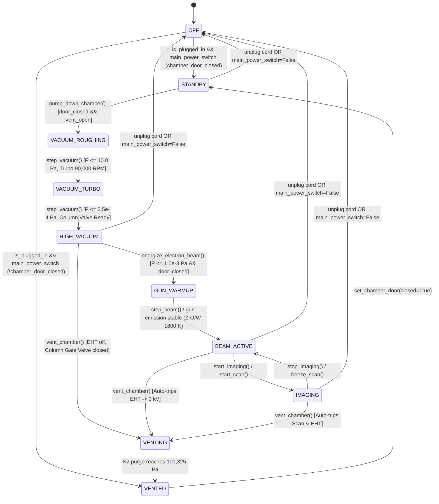

# Control Software, Electron Optics & Scan Physics Specification — `sem_twin`

## 1. Dual-Truth State Machine Architecture (`SEMController`)

Both `software/controller/sem_controller.py` and `software/viewer/app.js` implement the exact same 10-state deterministic finite state machine and hardware interlock matrix:



### Mandatory Hardware Interlocks (ZEISS `349500-8038-000` & `349347-9013-000`)
1. **Physical Circuit Continuity (`DIAG-014`)**:
   - `has_power = is_plugged_in and main_power_switch`.
   - Disconnecting `is_plugged_in` or turning `main_power_switch = False` immediately transitions `state -> OFF`, cuts `EHT` (`beam_enabled = False`), stops active raster scans (`is_scanning = False`), decelerates turbo/scroll pumps, blanks both 3D `UI_LCD` displays to `#05070a`, and silences `sfx.js`.
2. **High-Vacuum EHT Beam Interlock**:
   - `energize_electron_beam()` is **strictly blocked** unless:
     - `has_power == True`
     - `chamber_door_closed == True`
     - `chamber_pressure_pa <= 1.0e-3` (`1.0 mPa`)
     - `state in (STATE_HIGH_VACUUM, STATE_GUN_WARMUP, STATE_BEAM_ACTIVE, STATE_IMAGING)`
   - Attempting to energize the beam in `STATE_OFF`, `STATE_STANDBY` (`101,325 Pa`), `STATE_VACUUM_ROUGHING`, `STATE_VACUUM_TURBO`, `STATE_VENTING`, or `STATE_VENTED` raises `RuntimeError`.
3. **Chamber Door Vacuum & Stage Collision Interlock (`349347-9013-000` §2.3.3 & §3.4)**:
   - Opening the chamber door (`set_chamber_door(False)` / `open_chamber_door()`) is **blocked** while under vacuum (`chamber_pressure_pa < 95,000 Pa` -> raises `RuntimeError("Cannot open chamber door under vacuum; vent chamber first.")`).
   - Opening the chamber door requires stage tilt $|T| \le 1.0^\circ$ (or auto-homes tilt to $0^\circ$ when commanded via safe unload) and retracts the `BSE` detector (`bse_inserted = False`).
   - While `chamber_door_closed == False`, `EHT` and `SE2` collector bias are hardware-inhibited, and `Z` / `Tilt` stage motion is locked.

---

## 2. Vacuum Pumpdown & Venting Kinetics

- **Atmospheric Pressure**: $P_{\text{atm}} = 101,325.0\ \text{Pa}$.
- **Stage 1 — Oil-Free Scroll Roughing (`VACUUM_ROUGHING`, $101,325\ \text{Pa} \to 10.0\ \text{Pa}$)**:
  $$P(t + \Delta t) = \max\left(10.0,\ P(t) \cdot e^{-\Delta t / \tau_{\text{rough}}}\right)$$
  with scroll speed ramping to $1,800\ \text{RPM}$.
- **Stage 2 — Pfeiffer HiPace 300 Turbomolecular Pumpdown (`VACUUM_TURBO`, $10.0\ \text{Pa} \to 2.5 \times 10^{-4}\ \text{Pa}$)**:
  $$P(t + \Delta t) = \max\left(2.5 \times 10^{-4},\ P(t) \cdot 10^{-\Delta t / \tau_{\text{turbo}}}\right)$$
  with turbo rotor speed ramping to $90,000\ \text{RPM}$ (`1,500 Hz`) and FEG gun chamber Ion Getter Pump holding $P_{\text{IGP}} = 1.2 \times 10^{-7}\ \text{Pa}$.
- **Dry $\text{N}_2$ Venting (`VENTING`, $P \to 101,325\ \text{Pa}$)**:
  Closes pneumatic column isolation gate valve (`column_valve_open = False`), trips `EHT`, opens $\text{N}_2$ purge valve (`nitrogen_vent_open = True`), and returns chamber pressure to $101,325.0\ \text{Pa}$.

---

## 3. Electron Optics, Multi-Detector Contrast & Raster Scan Synthesis

### 3.1 Optical Parameters & Ranges
- **Accelerating Voltage (`accel_voltage_kv`)**: $0.02\text{--}30.0\ \text{kV}$ (default $5.0\ \text{kV}$).
- **Probe Current (`probe_current_pa`)**: $3.0\text{--}20,000.0\ \text{pA}$ (default $200.0\ \text{pA}$).
- **Magnification (`magnification`)**: $50\times\text{--}300,000\times$ (horizontal field width $\text{HFW} = \frac{120,000\ \mu\text{m}}{\text{Mag}}$).
- **Working Distance (`working_distance_mm`)**: $2.0\text{--}40.0\ \text{mm}$ (linked to stage $Z$; optimal focus distance $f_{\text{opt}} = \text{WD}$).
- **Objective Focus (`focus_mm`)**: Controlled via `Knob_CoarseFocus` ($\pm 5.0\ \text{mm}$) and `Knob_FineFocus` ($\pm 0.25\ \text{mm}$). Defocus blur radius in pixels:
  $$\sigma_{\text{defocus}} = k_f \cdot |f_{\text{lens}} - \text{WD}| \cdot \log_{10}(\text{Mag})$$
- **8-Pole Electromagnetic Stigmator (`stigmator_x`, `stigmator_y` $\in [-100\%, +100\%]$)**:
  Directional astigmatism kernel smear $(\Delta x_{\text{stig}}, \Delta y_{\text{stig}}) \propto (S_x - S_{x,\text{opt}}, S_y - S_{y,\text{opt}})$.

### 3.2 Physical Detector Signal Equations
For each pixel $(u, v)$ along the active raster scanline, specimen surface coordinates $(x_s, y_s)$ are transformed by 5-axis stage position $(X, Y, \text{Tilt}, \text{Rot})$ and magnification to evaluate height $h(x_s, y_s)$, surface gradient $\nabla h = (\partial_x h, \partial_y h)$, local surface normal tilt $\theta$, and local atomic number $Z(x_s, y_s)$:

1. **`InLens SE` (On-Axis Annular Secondary Electron Detector)**:
   $$I_{\text{InLens}}(x,y) = \text{Gain}_C \cdot \left(0.35 + 0.55 \cdot \sec(\theta) + 0.30 \cdot \|\nabla h\| + 0.15 \cdot h(x,y)\right) + \text{Bias}_B$$
   - High surface sensitivity, minimal directional shadow, enhanced edge yield $\propto \sec(\theta)$.
2. **`SE2` (Everhart-Thornley Chamber Detector at $+X/+Z$ Oblique Collector Angle)**:
   $$I_{\text{SE2}}(x,y) = \text{Gain}_C \cdot \left(0.25 + 0.48 \cdot \max(0, \hat{n} \cdot \hat{d}_{\text{SE2}}) + 0.38 \cdot \|\nabla h\|\right) + \text{Bias}_B$$
   - Strong 3D topographic relief and directional shadowing toward the right-rear Faraday collector cage.
3. **`4-Quad BSE` (Sense BSD Solid-State Backscatter Detector)**:
   $$\eta(Z) = -0.0254 + 0.016\,Z - 1.86\times 10^{-4}\,Z^2 + 8.3\times 10^{-7}\,Z^3 \approx 0.06 \cdot Z^{0.68}$$
   $$I_{\text{BSE}}(x,y) = \text{Gain}_C \cdot \left(0.85 \cdot \frac{\eta(Z(x,y))}{\eta(79)} + 0.15 \cdot (\hat{n} \cdot \hat{z})\right) + \text{Bias}_B$$
   - True atomic-number $Z$-contrast (heavy phases like $\text{Cu}$, $\text{Zn}$, $\text{Au}$, $\text{W}$ appear bright; light organic $\text{C}/\text{O}$ matrices appear dark).
4. **Dielectric Charging Artifact (Uncoated Biological/Polymer Samples at $\text{EHT} > 2.0\ \text{kV}$)**:
   - If `is_sputter_coated == False` and specimen conductivity $\sigma_e < 0.2$ and $\text{EHT} > 2.0\ \text{kV}$, excess trapped surface charge induces bright saturation bands and scanline phase jitter proportional to $(\text{EHT} - 2.0) \cdot I_{\text{probe}}$. Sputter-coating with `10 nm Au/Pd` (`sputter_coat_sample()`) eliminates charging and adds `Au Mα (2.120 keV)` / `Pd Lα (2.838 keV)` peaks to the EDS spectrum.
5. **Shot Noise & Dwell Time SNR**:
   $$\sigma_{\text{noise}} \propto \frac{1}{\sqrt{I_{\text{probe}} \cdot \tau_{\text{dwell}}}}$$
   - `Fast Survey (512×384, τ = 1.6 µs)` sweeps rapidly with noticeable quantum shot noise; `Slow Photo (1024×768, τ = 25.6 µs)` sweeps progressively with crisp, low-noise integration.

---

## 4. Specimen Catalog (6 Multi-Scale Scientific Samples)

| ID | Specimen Name | Default Mag | Substrate / Elements ($Z$) | Characteristic EDS X-Ray Peaks (keV) | Conductive Native? |
| :--- | :--- | ---: | :--- | :--- | :--- |
| `ommatidia` | *Drosophila melanogaster* Compound Eye | `1,500×` | Chitin cuticular hex facets + sensory bristles ($\text{C}, \text{N}, \text{O}, \text{Ca}$) | $\text{C K}\alpha\ 0.277$, $\text{N K}\alpha\ 0.392$, $\text{O K}\alpha\ 0.525$, $\text{Ca K}\alpha\ 3.691$ | No (requires `Au/Pd` coat or low kV) |
| `pollen` | *Ambrosia artemisiifolia* (Ragweed) Pollen | `4,500×` | Sporopollenin echinate spheres with conical spines ($\text{C}, \text{O}, \text{P}, \text{K}$) | $\text{C K}\alpha\ 0.277$, $\text{O K}\alpha\ 0.525$, $\text{P K}\alpha\ 2.013$, $\text{K K}\alpha\ 3.314$ | No (charges above `2.0 kV` if uncoated) |
| `morpho` | *Morpho rhetenor* Butterfly Wing Photonic Scale | `25,000×` | Chitinous longitudinal ridges (`700 nm` pitch) + cross-ribs ($\text{C}, \text{N}, \text{O}$) | $\text{C K}\alpha\ 0.277$, $\text{N K}\alpha\ 0.392$, $\text{O K}\alpha\ 0.525$ | No (charges above `2.0 kV` if uncoated) |
| `finfet` | `7 nm` FinFET CMOS Logic Die Cross-Section | `85,000×` | Epitaxial $\text{Si}$ fins, $\text{HfO}_2$ gate, $\text{W}$ contacts, $\text{Cu}$ M1 interconnects | $\text{O K}\alpha\ 0.525$, $\text{Cu L}\alpha\ 0.930$, $\text{Si K}\alpha\ 1.740$, $\text{W M}\alpha\ 1.775$, $\text{Cu K}\alpha\ 8.040$ | Yes (doped semiconductor + metal) |
| `zno_tetrapods` | Vapor-Phase $\text{ZnO}$ Nanotetrapod Whiskers | `35,000×` | Wurtzite hexagonal $\text{ZnO}$ 4-arm nanocrystals on $\text{Si}$ wafer | $\text{O K}\alpha\ 0.525$, $\text{Zn L}\alpha\ 1.012$, $\text{Si K}\alpha\ 1.740$, $\text{Zn K}\alpha\ 8.638$ | Semiconducting |
| `al_cu_alloy` | $\text{Al–4 wt\% Cu}$ Lamellar Eutectic Alloy ($\alpha\text{-Al} + \theta\text{-Al}_2\text{Cu}$) | `12,000×` | Polished metallurgical mount showing high-$Z$ $\text{Al}_2\text{Cu}$ lamellae in $\alpha\text{-Al}$ | $\text{Cu L}\alpha\ 0.930$, $\text{Al K}\alpha\ 1.486$, $\text{Cu K}\alpha\ 8.040$ | Yes (metallic alloy — ideal for BSE $Z$-contrast) |

---

## 5. GLP Audit Trail & Analytical CSV Telemetry Schema

Exported via `export_glp_csv()` (Python) and `Export EDS / GLP CSV` (Web UI):

```csv
timestamp_utc,instrument_id,state,is_plugged_in,chamber_pressure_pa,igp_pressure_pa,turbo_rpm,specimen_id,sputter_coated,detector,eht_kv,probe_current_pa,magnification,working_distance_mm,focus_mm,stigmator_x,stigmator_y,stage_x_mm,stage_y_mm,stage_z_mm,stage_tilt_deg,stage_rot_deg,scan_mode,dwell_time_us,eds_dominant_peaks_kev
```
