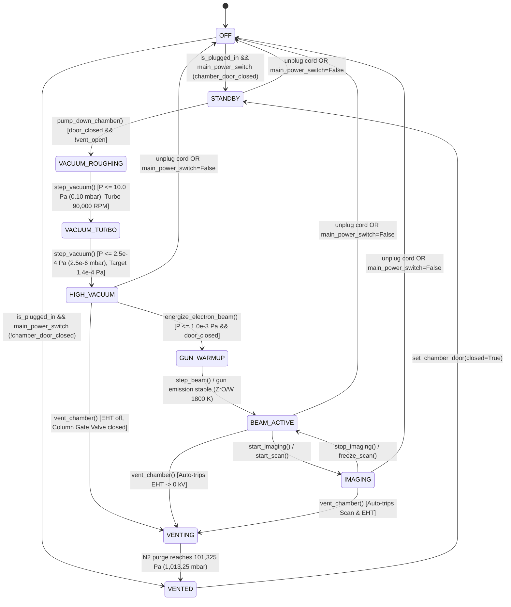

# Control Software, Electron Optics & Scan Physics Specification — `sem_twin`

## 1. Dual-Truth State Machine Architecture (`SEMController`)

Both `software/controller/sem_controller.py` and `software/viewer/app.js` implement the exact same 10-state deterministic finite state machine and hardware interlock matrix:



### Mandatory Hardware Interlocks (ZEISS `349500-8038-000` & `349347-9013-000`)
1. **Physical Circuit Continuity (`DIAG-014`)**:
   - `has_power = is_plugged_in and main_power_switch`.
   - Disconnecting `is_plugged_in` or turning `main_power_switch = False` immediately transitions `state -> OFF`, cuts `EHT` (`beam_enabled = False`), stops active raster scans (`is_scanning = False`), decelerates turbo/scroll pumps, blanks both 3D `UI_LCD` & `UI_LCD_ChamberScope` displays to `#05070a`, and silences `sfx.js`.
2. **High-Vacuum EHT Beam Interlock**:
   - `energize_electron_beam()` is **strictly blocked** unless:
     - `has_power == True`
     - `chamber_door_closed == True`
     - `chamber_pressure_pa <= 1.0e-3` (`1.0e-5 mbar`)
     - `state in (STATE_HIGH_VACUUM, STATE_GUN_WARMUP, STATE_BEAM_ACTIVE, STATE_IMAGING)`
   - Attempting to energize the beam in `STATE_OFF`, `STATE_STANDBY` (`101,325 Pa` / `1,013.25 mbar`), `STATE_VACUUM_ROUGHING`, `STATE_VACUUM_TURBO`, `STATE_VENTING`, or `STATE_VENTED` raises `RuntimeError`.
3. **Chamber Door Vacuum & Stage Collision Interlock (`349347-9013-000` §2.3.3 & §3.4)**:
   - Calling `close_chamber_door(False)` while under vacuum (`chamber_pressure_pa < 95000` Pa, i.e., `< 950 mbar`) **MUST raise**:
     ```python
     RuntimeError("Cannot open chamber door under vacuum; vent chamber first.")
     ```
   - Opening the chamber door requires stage tilt $|T| \le 1.0^\circ$ (or auto-homes tilt to $0^\circ$) and retracts the `BSE` detector (`bse_retracted = True`).
   - While `chamber_door_closed == False`, `EHT` and `SE2` collector bias are hardware-inhibited, and `Z` / `Tilt` stage motion is locked (`RuntimeError`).

---

## 2. Vacuum Pumpdown & Venting Kinetics (`1 mbar = 100 Pa`)

| Vacuum Stage / Parameter | SI Pressure (Pa) | Millibar Equivalence (`1 mbar = 100 Pa`) | Actuator / Gauge |
| :--- | ---: | ---: | :--- |
| **Atmospheric Vent (`P_atm`)** | `101,325.0 Pa` | `1,013.25 mbar` | Dry $\text{N}_2$ purge valve / `Body_GaugePiraniPenning` |
| **Chamber Door Safe-Open Threshold** | `>= 95,000.0 Pa` | `>= 950.0 mbar` | `Body_MicroswitchDoor` + differential pressure interlock |
| **Roughing Crossover (`VACUUM_ROUGHING -> TURBO`)** | `10.0 Pa` | `0.10 mbar` (`1.0e-1 mbar`) | `Pfeiffer HiScroll 6` dry scroll (`1,800 RPM`) |
| **High Vacuum Ready Threshold (`HIGH_VACUUM`)** | `<= 2.5e-4 Pa` | `<= 2.5e-6 mbar` | `Pfeiffer HiPace 300` turbo (`90,000 RPM`, `260 l/s`) |
| **Operating Target Vacuum (`UHV_READY`)** | `1.4e-4 Pa` | `1.4e-6 mbar` | Nominal analytical specimen chamber baseline |
| **FEG Gun Chamber IGP Vacuum (`igp_pressure_pa`)** | `2.0e-8 Pa` | `2.0e-10 mbar` | `20 l/s` `Body_IonGetterPump` (isolated by gate valve) |

- **Stage 1 — Oil-Free Scroll Roughing (`VACUUM_ROUGHING`, $101,325\ \text{Pa} \to 10.0\ \text{Pa}$)**:
  $$P(t + \Delta t) = \max\left(10.0,\ P(t) \cdot e^{-\Delta t / \tau_{\text{rough}}}\right)$$
  with scroll speed ramping to $1,800\ \text{RPM}$.
- **Stage 2 — Pfeiffer HiPace 300 Turbomolecular Pumpdown (`VACUUM_TURBO`, $10.0\ \text{Pa} \to 2.5 \times 10^{-4}\ \text{Pa} \to 1.4 \times 10^{-4}\ \text{Pa}$)**:
  $$P(t + \Delta t) = \max\left(1.4 \times 10^{-4},\ P(t) \cdot 10^{-\Delta t / \tau_{\text{turbo}}}\right)$$
  with turbo rotor speed ramping to $90,000\ \text{RPM}$ (`1,500 Hz`) and FEG gun chamber Ion Getter Pump holding $P_{\text{IGP}} = 2.0 \times 10^{-8}\ \text{Pa}$ (`2.0e-10 mbar`).
- **Dry $\text{N}_2$ Venting (`VENTING`, $P \to 101,325\ \text{Pa}$)**:
  Closes pneumatic column isolation gate valve (`column_valve_open = False`), trips `EHT`, opens $\text{N}_2$ purge valve (`nitrogen_vent_open = True`), and returns chamber pressure to $101,325.0\ \text{Pa}$ (`1,013.25 mbar`).

---

## 3. Electron Optics, Multi-Detector Contrast & Raster Scan Synthesis

### 3.1 Optical Parameters & Ranges
- **Accelerating Voltage (`accel_voltage_kv` / `EHT`)**: $0.02\text{--}30.0\ \text{kV}$ (default $5.0\ \text{kV}$).
- **Probe Current (`probe_current_pa`)**: $3.0\text{--}20,000.0\ \text{pA}$ (default $200.0\ \text{pA}$).
- **Objective Aperture Strip (`aperture_um`)**: $30.0,\ 60.0,$ or $120.0\ \mu\text{m}$ (default $30.0\ \mu\text{m}$).
- **Magnification (`magnification`)**: $50\times\text{--}300,000\times$ (Horizontal Field Width $\text{HFW} = \frac{120,000\ \mu\text{m}}{\text{Mag}}$).
- **Working Distance / Stage Z (`working_distance_mm` / `stage_z_mm`)**: $2.0\text{--}40.0\ \text{mm}$ (linked to stage $Z$; optimal focus distance $f_{\text{opt}} = \text{WD}$).
- **Objective Focus (`focus_mm`)**: Controlled by Coarse (`Knob_FocusCoarse`, `0..100`) and Fine (`Knob_FocusFine`, `0..100`) rotary encoders rotating clockwise (`CW`) to increase:
  $$f_{\text{lens}} = \text{clamp}\left(1.0,\ 45.0,\ \text{WD} + (\text{Coarse} - 50)\cdot 0.08 + (\text{Fine} - 50)\cdot 0.005\right)$$
  Defocus blur radius in pixels:
  $$\sigma_{\text{defocus}} = 2.4 \cdot |f_{\text{lens}} - \text{WD}| \cdot \log_{10}(\max(50, \text{Mag}))$$
- **8-Pole Electromagnetic Stigmator (`stigmator_x`, `stigmator_y` $\in [-100\%, +100\%]$)**:
  Directional astigmatism kernel smear $(\Delta x_{\text{stig}}, \Delta y_{\text{stig}}) \propto (S_x - S_{x,\text{opt}}, S_y - S_{y,\text{opt}})$.
- **Relativistic Electron de Broglie Wavelength & Mean Free Path**:
  $$\lambda_e = \frac{h}{\sqrt{2 m_0 e V \left(1 + \frac{e V}{2 m_0 c^2}\right)}}, \qquad \lambda_{\text{MFP}} = \frac{6.8 \times 10^{-3}}{P_{\text{Pa}}} = \frac{6.8 \times 10^{-5}}{P_{\text{mbar}}}\ \text{[m]}$$

### 3.2 Physical Detector Signal Equations
For each pixel $(u, v)$ along the active raster scanline, specimen surface coordinates $(x_s, y_s)$ are transformed by 5-axis stage position $(X, Y, \text{Tilt}, \text{Rot})$ and magnification to evaluate height $h(x_s, y_s)$, surface gradient $\nabla h = (\partial_x h, \partial_y h)$, local surface normal tilt $\theta$, and local atomic number $Z(x_s, y_s)$:

1. **`InLens SE` (`InLens_Secondary`, On-Axis Annular Secondary Electron Detector)**:
   $$I_{\text{InLens}}(x,y) = \text{Gain}_C \cdot \left(0.35 + 0.55 \cdot \sec(\theta) + 0.30 \cdot \|\nabla h\| + 0.15 \cdot h(x,y)\right) + \text{Bias}_B$$
   - High surface sensitivity, minimal directional shadow, enhanced edge yield $\propto \sec(\theta)$.
2. **`SE2` (`SE2_Everhart_Thornley`, Chamber Detector with Biased Faraday Collector Cage)**:
   $$I_{\text{SE2}}(x,y) = \text{Gain}_C \cdot \left(0.25 + 0.48 \cdot \max(0, \hat{n} \cdot \hat{d}_{\text{SE2}}) + 0.38 \cdot \|\nabla h\|\right) + \text{Bias}_B$$
   - Strong 3D topographic relief and directional shadowing toward the Faraday collector cage.
3. **`4-Quad BSE` (`BSE_Backscatter`, Sense BSD Solid-State Backscatter Detector)**:
   $$\eta(Z) = -0.0254 + 0.016\,Z - 1.86\times 10^{-4}\,Z^2 + 8.3\times 10^{-7}\,Z^3 \approx 0.06 \cdot Z^{0.68}$$
   $$I_{\text{BSE}}(x,y) = \text{Gain}_C \cdot \left(0.85 \cdot \frac{\eta(Z(x,y))}{\eta(79)} + 0.15 \cdot (\hat{n} \cdot \hat{z})\right) + \text{Bias}_B$$
   - True atomic-number $Z$-contrast (heavy phases like $\text{Cu}$, $\text{Zn}$, $\text{Hf}$, $\text{W}$, $\text{Au}$ appear bright; light organic $\text{C}/\text{O}$ matrices appear dark).
4. **Dielectric Charging Artifact & `5.0 nm` Au/Pd Sputter Coating**:
   - If `is_sputter_coated == False` and specimen conductivity is non-conductive (`conductive_native == False`) at $\text{EHT} > 2.0\ \text{kV}$, trapped surface charge induces bright saturation streaks and scanline phase jitter proportional to $(\text{EHT} - 2.0) \cdot I_{\text{probe}}$.
   - Sputter-coating with a **`5.0 nm` `Au/Pd` conductive film** (`sputter_thickness_nm = 5.0`) bleeds off trapped electrons, eliminates charging, and adds `Au Mα (2.120 keV)` / `Pd Lα (2.838 keV)` peaks to the SDD EDS spectrum.
5. **Shot Noise & Dwell Time SNR**:
   $$\sigma_{\text{noise}} \propto \frac{1}{\sqrt{I_{\text{probe}} \cdot \tau_{\text{dwell}}}}$$
   - `Fast Survey (512×384, τ = 1.6 µs)` sweeps rapidly with quantum shot noise; `Slow Photo (1024×768, τ = 25.6 µs)` integrates progressively with high SNR.

---

## 4. Specimen Catalog (6 Monograph Specimens + 3 Calibration Substrates on 9-Slot Carousel)

The 9-position aluminum pin-stub carousel (`Body_SpecimenCarousel`, `9` equal `40°` slots on `Ø 12.7 mm` stubs) holds **6 active monograph specimens** plus **3 calibration substrates** (`Cu/Au` calibration grid, `Si` resolution standard, and Faraday cup):

| Slot / ID | Specimen Name | Default Mag | Optimal EHT / WD | Substrate / Elements | Characteristic EDS X-Ray Peaks (keV) | Conductive Native? |
| :--- | :--- | ---: | ---: | :--- | :--- | :--- |
| `1` · `ommatidia` | *Drosophila melanogaster* Compound Eye | `15,000×` | `5.0 kV` / `8.5 mm` | Chitin hex corneal facets + sensory bristles (`C, O, N, Ca`) | $\text{C K}\alpha\ 0.277$, $\text{N K}\alpha\ 0.392$, $\text{O K}\alpha\ 0.525$, $\text{Ca K}\alpha\ 3.691$ | Non-conductive (`5.0 nm Au/Pd`) |
| `2` · `pollen` | *Hibiscus syriacus* (Echinate Pollen Grain) | `12,000×` | `3.0 kV` / `9.0 mm` | Sporopollenin echinate spheres on carbon tape (`C, O, Ca, K`) | $\text{C K}\alpha\ 0.277$, $\text{O K}\alpha\ 0.525$, $\text{K K}\alpha\ 3.314$, $\text{Ca K}\alpha\ 3.691$ | Non-conductive (`5.0 nm Au/Pd`) |
| `3` · `morpho` | *Morpho rhetenor* Photonic Wing Scale | `45,000×` | `2.0 kV` / `6.5 mm` | Chitinous longitudinal ridges (`700 nm`) + trabeculae (`C, O, N`) | $\text{C K}\alpha\ 0.277$, $\text{N K}\alpha\ 0.392$, $\text{O K}\alpha\ 0.525$ | Non-conductive (`5.0 nm Au/Pd`) |
| `4` · `finfet` | `5 nm` FinFET CMOS Logic Gate Cross-Section | `120,000×` | `15.0 kV` / `5.0 mm` | Cleaved `Si` fins, $\text{HfO}_2$ gate, `W` plugs, `Cu` M1 (`Si, O, W, Hf, Cu`) | $\text{O K}\alpha\ 0.525$, $\text{Cu L}\alpha\ 0.930$, $\text{Hf M}\alpha\ 1.645$, $\text{Si K}\alpha\ 1.740$, $\text{W M}\alpha\ 1.775$, $\text{Cu K}\alpha\ 8.040$ | Conductive |
| `5` · `zno_tetrapods` | `ZnO` Wurtzite Tetrapod Nanowires | `65,000×` | `10.0 kV` / `7.5 mm` | 4-arm `[0001]` hexagonal wurtzite nanocrystals (`Zn, O, Al`) | $\text{O K}\alpha\ 0.525$, $\text{Zn L}\alpha\ 1.012$, $\text{Al K}\alpha\ 1.486$, $\text{Zn K}\alpha\ 8.638$ | Semiconducting |
| `6` · `al_cu_alloy` | `AA2024-T3` `Al–Cu–Mg–Si` Aerospace Alloy | `25,000×` | `20.0 kV` / `8.5 mm` | $\alpha\text{-Al}$ matrix + $\theta\text{-Al}_2\text{Cu}$ precipitates (`Al, Cu, Mg, Si, Mn`) | $\text{Cu L}\alpha\ 0.930$, $\text{Mg K}\alpha\ 1.253$, $\text{Al K}\alpha\ 1.486$, $\text{Si K}\alpha\ 1.740$, $\text{Mn K}\alpha\ 5.898$, $\text{Cu K}\alpha\ 8.040$ | Conductive (`4Q-BSE Z-Contrast`) |
| `7–9` · `cal_substrates` | `Cu/Au` Grid, `Si` Resolution Standard, Faraday Cup | — | — | Calibration standards & beam-current Faraday trap (`Cu, Au, Si`) | Reference magnification, resolution & probe-current calibration | Conductive calibration targets |

---

## 5. GLP Audit Trail & Analytical CSV Telemetry Schema

Exported via `export_glp_csv()` (Python) and `Export GLP CSV` (Web UI), recording SI Pascals and millibar equivalence alongside full optics and EDS data:

```csv
timestamp_utc,instrument_id,state,is_plugged_in,chamber_pressure_pa,chamber_pressure_mbar,igp_pressure_pa,igp_pressure_mbar,turbo_rpm,specimen_id,sputter_coated,sputter_thickness_nm,detector,eht_kv,probe_current_pa,aperture_um,magnification,working_distance_mm,focus_mm,stigmator_x,stigmator_y,stage_x_mm,stage_y_mm,stage_z_mm,stage_tilt_deg,stage_rot_deg,scan_mode,dwell_time_us,de_broglie_wavelength_pm,resolution_nm,mean_free_path_m,eds_dominant_peaks_kev
```
