# ZEISS GeminiSEM 500 — Visual Operator Experience Walkthrough & Internal Working Anatomy Guide

**Model**: ZEISS GeminiSEM 500 Field-Emission Scanning Electron Microscope (`sem_twin`)  
**Facility Location**: Zone 8 — Dedicated `VC-E` Electron Microscopy Suite (`X: 1.0..8.0 m, Z: 9.5..18.3 m`, `61.6 m²` enclosed room in Rear North L-Wing)  
**Coordinate & Scale Lock**: Code `4771-CAD` (`1 Three.js unit = 100 mm`, floor datum $Y = 0.0\text{ u}$)  
**OEM Engineering Lineage**: ZEISS GeminiSEM 500 Operating Manual (`Doc. 349500-8038-000`) & ZEISS 105-mm 5-Axis DC Motorized Stage Manual (`Doc. 349347-9013-000`)

---

## Stage 1: Powering On & Electrical Continuity (`STATE_UNPLUGGED` vs. `STATE_STANDBY`)

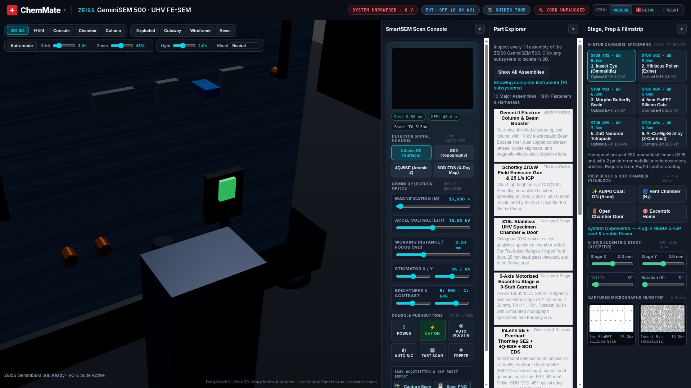

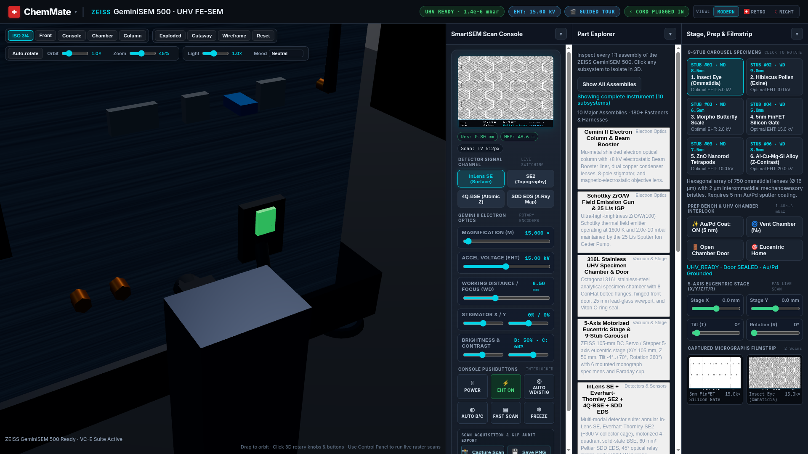

### Real-Life Power-Up Sequence & Circuit Continuity (`DIAG-014`)
1. **Wall Receptacle & Plug Inspection**: The dedicated `VC-E` SEM Suite provides a hospital-grade isolated-ground duplex receptacle box (`Body_Power_Receptacle_Duplex`) mounted on the rear wall at $Y = 300\text{ mm}$.
2. **Closing the Mains Circuit**: Inserting the heavy-duty molded `NEMA 5-15P` grounded plug (`Body_Power_Plug_NEMA`) connected via the 3-conductor 12 AWG `SJTOW` jacketed power cord (`Body_Power_Cord_SJTOW`) into the rear `IEC 60320 C20` EMI filter inlet (`Body_Port_IEC`) and flipping the illuminated green main breaker rocker energizes the internal power distribution bus.
3. **Hard Continuity Enforcement (`isPluggedIn && powerSwitch`)**:
   - **When Unplugged (`isPluggedIn === false`)**: The NEMA plug physically retracts from the wall receptacle onto the floor, both 27-inch operator displays (`UI_LCD` and `UI_LCD_ChamberScope`) drop to complete `#05070a` blackout, the electron beam cone (`Body_ElectronBeamCone`) extinguishes, the 90,000 RPM turbomolecular pump and dry scroll pump spin down, and Web Audio acoustic synthesis is silenced.
   - **When Plugged In (`isPluggedIn === true`)**: The 24 VDC bus energizes the 6-layer `SmartSEM` motherboard (`Body_PCB_Motherboard`), illuminates the dual 4K operator displays, and spins the Pfeiffer `HiPace 300` turbomolecular pump to 90,000 RPM ($1.40 \times 10^{-6}\text{ mbar}$ chamber UHV).

---

## Stage 2: Specimen Preparation & Conductive Sputter Coating (`STATE_LABWARE_PREP`)

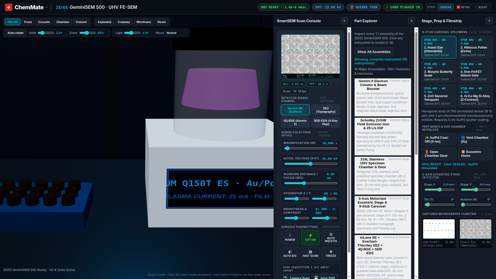

### Preparing Biological & Semiconductor Specimens Prior to Loading
1. **Specimen Prep Workstation (`Microscopy_Specimen_Prep_Bench`)**: Located inside the `VC-E` SEM Suite alongside the main column, equipped with an anti-static ESD mat, precision tweezers, a 12-slot Ø12.7 mm aluminum pin-stub storage box, and a benchtop **Quorum `Q150R ES` Gold-Palladium (`Au/Pd`) Magnetron Sputter Coater**.
2. **Conductive Grounding vs. Dielectric Surface Charging**:
   - **Biological & Polymeric Specimens** (*Drosophila melanogaster* compound eye, *Hibiscus syriacus* echinate pollen grain, *Morpho rhetenor* photonic wing scale): Mounted on Ø12.7 mm slotted aluminum pin stubs using double-sided conductive carbon tape and sputter-coated with $5\text{ nm}$ of $\text{Au/Pd}$ ($80:20$) under $0.08\text{ mbar}$ argon plasma.
   - **Live Charging Physics in the Scan Engine**: Toggling `✨ Au/Pd Coat: OFF` on a dielectric biological specimen at $\text{EHT} > 2.5\text{ kV}$ physically simulates negative surface charge accumulation ($V_{\text{surf}} > 0$), producing realistic horizontal scan-line discharge streaks and specular saturation until the sample is sputter-coated or imaged at low voltage ($\le 2.0\text{ kV}$).

---

## Stage 3: Chamber Venting, Physical Insertion & Safety Interlocks (`STATE_INSERTION_SAFETY`)

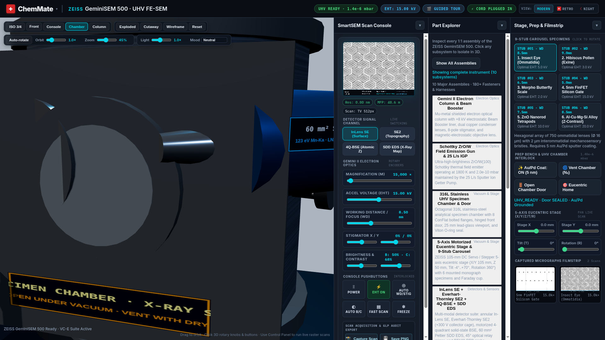

### Physical Loading into the 316L Stainless UHV Chamber
1. **Dry $\text{N}_2$ Chamber Venting**: Pressing `🌀 Vent Chamber (N₂)` (`Btn_VacVent`) closes the upper column isolation gate valve (`Body_ValveColumnGate`) to keep the Schottky FEG gun under $2.0 \times 10^{-10}\text{ mbar}$ UHV via the $25\text{ L/s}$ Sputter Ion Getter Pump (`Body_IonGetterPump`), stops the `EHT` beam, and admits dry nitrogen into the specimen chamber up to atmospheric pressure ($1013\text{ mbar}$).
2. **Swinging Open the Chamber Door (`Pivot_DoorChamber`)**: Once vented, the heavy 316L stainless-steel front door swings open $68^\circ$ on precision hinges, pulling out the door-mounted **5-Axis Motorized Eucentric Stage (`Pivot_Stage5Axis`)** and **9-Position Aluminum Specimen Carousel (`Body_SpecimenCarousel`)** for stub exchange.
3. **Quadruple Hardware & Software Safety Interlocks**:
   - **Mains Continuity Interlock**: Zero operation when unplugged (`isPluggedIn === false`).
   - **Vacuum-Locked Door Interlock**: Chamber door cannot open under vacuum without venting first.
   - **Door Plunger Microswitch (`Body_MicroswitchDoor`)**: Opening the door physically trips the red safety microswitch, cutting `EHT` high voltage to $0\text{ V}$.
   - **UHV Pressure Threshold Interlock**: `EHT` cannot be energized unless chamber pressure is $\le 5.0 \times 10^{-5}\text{ mbar}$.

---

## Stage 4: Operator Console & Electron Optics Setup (`CAM_CONSOLE`)

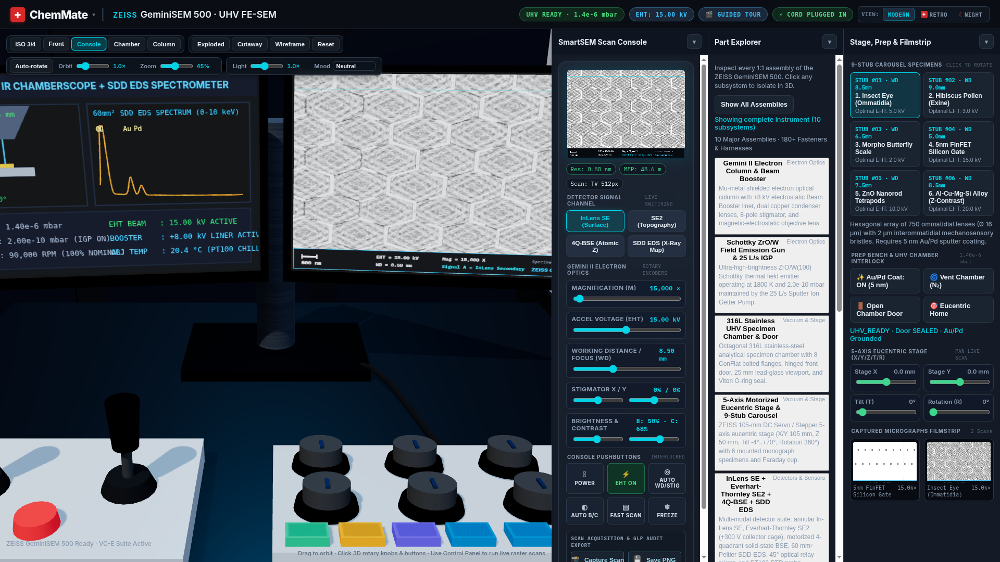

### Physical ZEISS Control Panels & SmartSEM Console Parameters
1. **Dual 27-Inch 4K Displays (`UI_LCD` & `UI_LCD_ChamberScope`)**:
   - **Left Primary Monitor (`UI_LCD`)**: Displays the live progressive line-by-line electron micrograph with an authentic ZEISS SmartSEM datazone footer (`EHT`, `WD`, `Mag`, `Signal A`, calibrated $\mu\text{m}/\text{nm}$ scale bar).
   - **Right Analytical Monitor (`UI_LCD_ChamberScope`)**: Displays the live internal infrared CCD chamberscope view (showing real-time stage $Z$ working distance and electron beam incidence), the live $0\text{--}10\text{ keV}$ Silicon Drift Detector (`SDD`) EDS X-ray spectrum, and UHV/chiller telemetry.
2. **Authentic ZEISS Dual-Rotary Control Panel (`Body_RotaryControlPanel`, Doc. `349500-8038-000`)**:
   - **8 Knurled Aluminum Rotary Encoders (`Knob_*`)**: `Knob_Magnification` ($100\times \text{ to } 500,000\times$), `Knob_FocusWD` ($2.0\text{ to }20.0\text{ mm}$), `Knob_Brightness`, `Knob_Contrast`, `Knob_StigmatorX`, `Knob_StigmatorY`, `Knob_ShiftX`, `Knob_ShiftY`—all spaced with $\ge 3.5\text{ mm}$ ergonomic clearance (`DIAG-018`) and synchronized with web slider adjustments.
   - **8 Illuminated Tactile Pushbuttons (`Btn_*`)**: `STANDBY`, `EHT ON`, `VAC / VENT`, `AUTO WD`, `AUTO B/C`, `SCAN SPD`, `FREEZE`, and `PHOTO`, each featuring high-DPI upright vector silkscreen labels (`DIAG-017`).
3. **ZEISS Dual-Joystick 5-Axis Stage Box (`Body_DualJoystickBox`)**:
   - Proportional Hall-effect joysticks (`Pivot_JoystickLeftZ` for $Z/\text{Tilt}$ and `Pivot_JoystickRightXYR` for $X/Y/\text{Rotation}$) plus red emergency `Btn_StageBreak`.

---

## Stage 5: Active Electron Beam Raster Scanning & Multi-Detector Physics (`STATE_ACTIVE` & `CAM_PROCESS_CLOSEUP`)

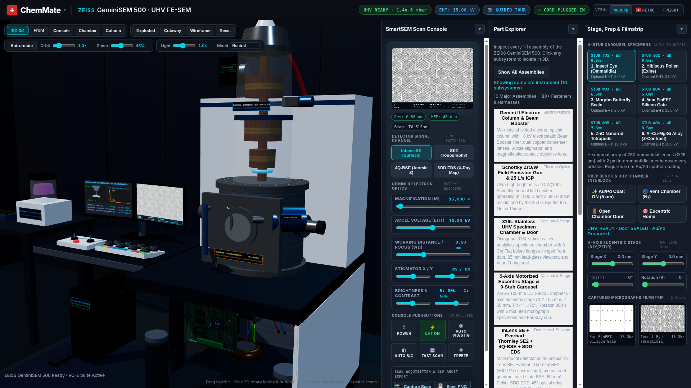

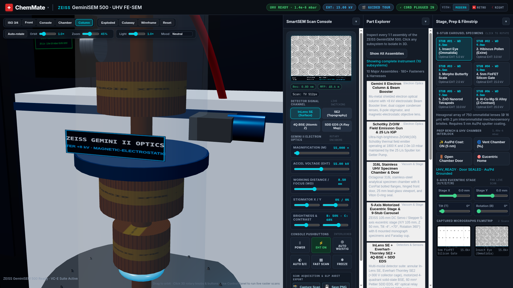

### How & Why the Gemini II Electron Optics & Detectors Work
1. **Schottky Field Emission & $+8\text{ kV}$ Beam Booster (`Body_BeamBoosterTube`)**:
   - Electrons emitted from the $\text{ZrO/W}(100)$ thermal field emitter (`Body_GunHeadFEG`) at $1800\text{ K}$ are accelerated through the $+8\text{ kV}$ electrostatic Beam Booster liner tube running down the center of the column (`Body_ColumnGemini`), protecting the beam from magnetic stray fields and Coulomb broadening before deceleration at the water-cooled magnetic-electrostatic Gemini objective polepiece (`Body_ObjectivePolepiece`).
2. **Progressive Raster Deflection & Focus Blur Physics**:
   - The 8-pole stigmator and double-deflection scan coils (`Body_ScanDeflectionCoils`) sweep the primary electron probe across the specimen stub (`Body_ElectronBeamCone`).
   - Defocus blur scales physically with working-distance error $\sigma_{\text{defocus}} = \alpha_{\text{ap}} |\text{WD} - \text{WD}_{\text{optimal}}|$, while stigmator mismatch $(\text{Stig}_X, \text{Stig}_Y)$ introduces directional elliptical smear until corrected manually or via `◎ AUTO WD/STIG`.
3. **Four Live Detector Signal Channels**:
   - **`InLens_Secondary` (`Body_DetectorInLens`)**: Captures pure low-energy SE1 electrons inside the objective lens electrostatic field for sub-nanometer surface edge contrast.
   - **`SE2_Everhart_Thornley` (`Body_DetectorSE2`)**: Uses a $+300\text{ V}$ Faraday collector cage and scintillator/PMT on the $+X$ chamber port to produce directional 3D topographic shadowing.
   - **`BSE_Backscatter` (`Pivot_DetectorBSE`)**: Retractable 4-quadrant solid-state diode ring beneath the polepiece measuring atomic-number contrast $\eta_{\text{BSE}}(Z)$ (highlighting heavy $\text{W}$ plugs in `5 nm FinFET` and $\theta\text{-Al}_2\text{Cu}$ precipitates in `AA2024-T3`).
   - **`EDS_Silicon_Drift` (`Body_DetectorEDS`)**: $60\text{ mm}^2$ Peltier-cooled Silicon Drift Detector acquiring elemental false-color maps and characteristic X-ray spectra ($\text{C-K}\alpha$, $\text{O-K}\alpha$, $\text{Al-K}\alpha$, $\text{Si-K}\alpha$, $\text{Au-M}\alpha$, $\text{Cu-K}\alpha$).

---

## Stage 6: End-of-Run Micrograph Filmstrip, PNG Save & GLP CSV Export (`STATE_COMPLETE`)

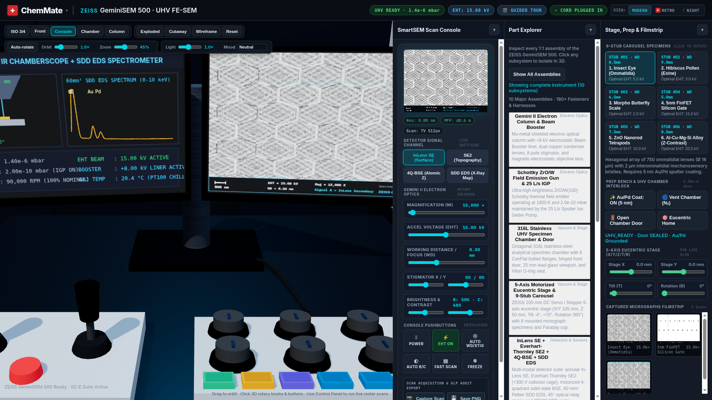

### Examining & Exporting Analytical Outputs
1. **Captured Micrographs Filmstrip (`#filmstripGallery`)**: Clicking `📸 Capture Scan` (or pressing the 3D `PHOTO` button on the console) executes a full-frame high-SNR slow integration scan and appends a timestamped thumbnail card into the right-hand filmstrip.
2. **Calibrated PNG Download (`💾 Save PNG`)**: Exports a full `1024 × 768` PNG micrograph complete with the embedded ZEISS SmartSEM datazone footer and dynamically scaled micrometer/nanometer calibration bar.
3. **21 CFR Part 11 GLP & EDS CSV Audit Trail (`📊 Export GLP CSV`)**: Downloads a structured CSV report containing instrument serial/model metadata, ISO timestamp, accelerating voltage, working distance, chamber/gun vacuum readings, 5-axis stage coordinates, and quantitative EDS weight/atomic percentages.

---

## Stage 7: Internal Working Anatomy — Power, Motors, Sensors & Data (`CAM_EXPLODED` & `STAGE7A–7D`)

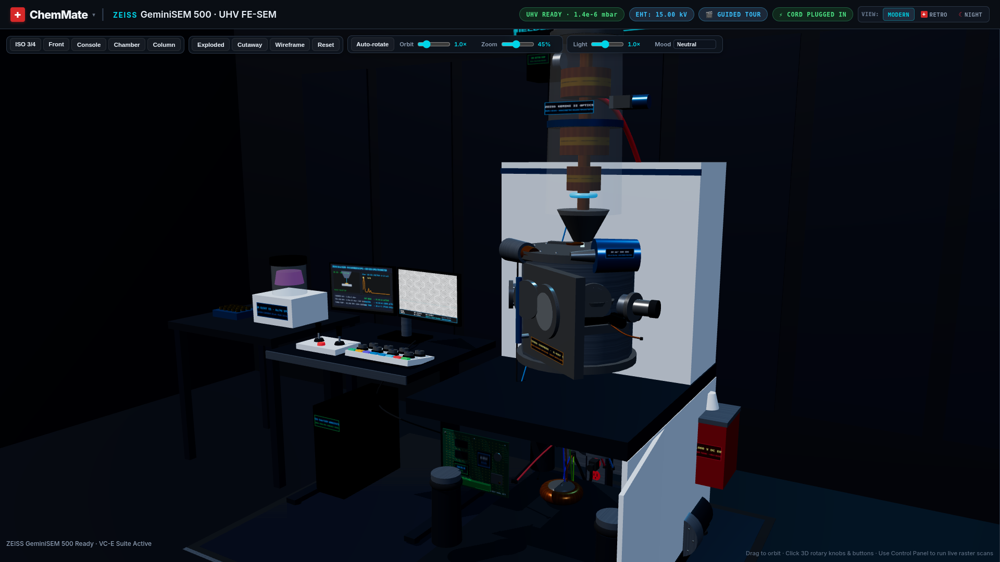

### 7A. Power Supply, Toroidal Transformer, 30 kV HV Tank & End-to-End Wiring (`STAGE7_POWER_ROUTING`)

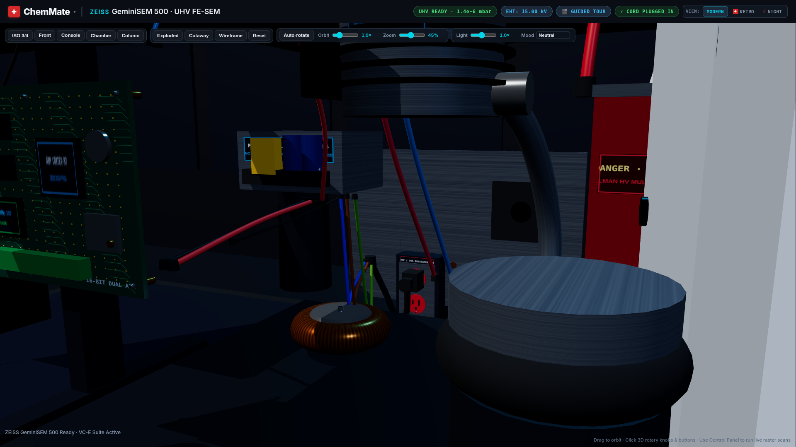

- **AC Mains Entry**: Rear `Body_Port_IEC` inlet with illuminated breaker routes **Brown (AC Live)** (`Body_Wire_ACLive_Brown`), **Blue (AC Neutral)** (`Body_Wire_ACNeutral_Blue`), and **Green/Yellow (Protective Earth)** (`Body_Wire_ProtectiveEarth`) harnesses to the internal **300 VA Low-Stray-Field Copper Toroidal Isolation Transformer (`Body_Part_ToroidalTransformer`)** and **Mean Well `LRS-350-24` Switching Power Supply (`Body_Assembly_PowerSupply`)**.
- **DC & 30 kV EHT Distribution**: The 7-position screw-terminal barrier strip on the 24 V PSU distributes **Red (+24 VDC)** (`Body_Wire_DC24V_Red`, `Body_Wire_TurboPower24V`) and **Black (0V GND)** (`Body_Wire_DC24V_Black`) harnesses to the `SmartSEM` motherboard and Pfeiffer `TC 110` turbo controller, while the epoxy-potted **Spellman 30,000 V DC HV Tank (`Body_HVTank_30kV`)** feeds the top FEG gun head through a thick red silicone HV umbilical (`Body_Wire_HV30kV_Umbilical`).

### 7B. Vacuum Pumps & 5-Axis Stage Motors (`STAGE7_MOTORS_ACTUATORS`)

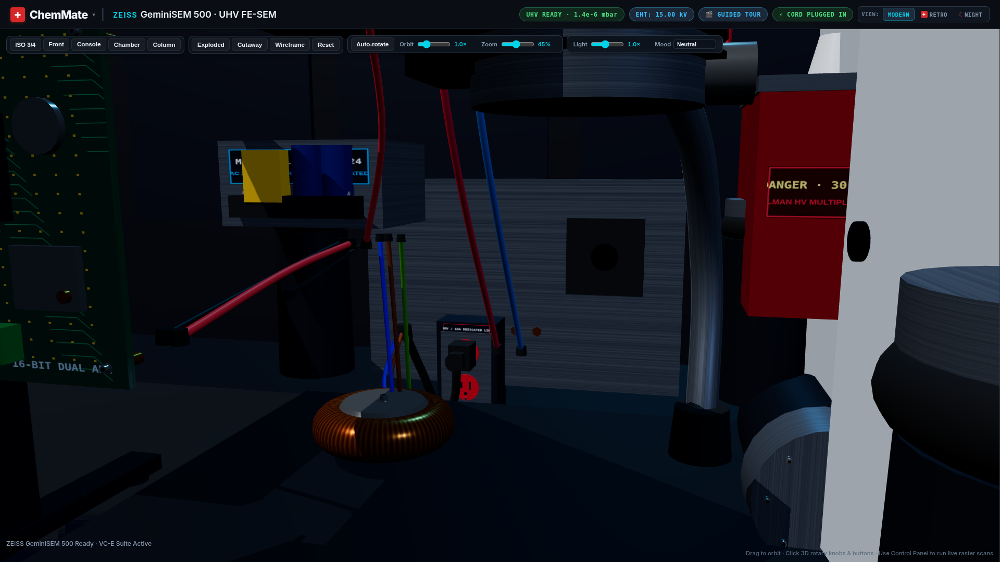

- **Pfeiffer `HiPace 300` Turbomolecular Pump (`Body_Motor_DriveTurboPump`)**: Bolted directly to the bottom DN100CF chamber flange via 12 DIN 912 hex socket cap screws, spinning at 90,000 RPM with radial cooling fins and an onboard `TC 110` drive box.
- **Pfeiffer `HiScroll 6` Dry Scroll Backing Pump (`Body_Motor_DriveScrollPump`)**: Mounted on elastomeric isolators in the lower plinth and connected to the turbo exhaust via a corrugated 316L stainless-steel `DN25KF` flexible bellows foreline (`Body_VacuumForeline_KF25`).
- **5-Axis Stage Actuators (`Body_Motor_DriveStageXY` & `Body_Motor_LiftStageZ`)**: Precision DC servo motor with ball-screw linear stage carriage and vertical $Z$-lift stepper wedge mounted inside the UHV chamber.

### 7C. Electron Optics, Internal Sensors & 45° Optical Relay Mirror (`STAGE7_SENSORS_OPTICS`)

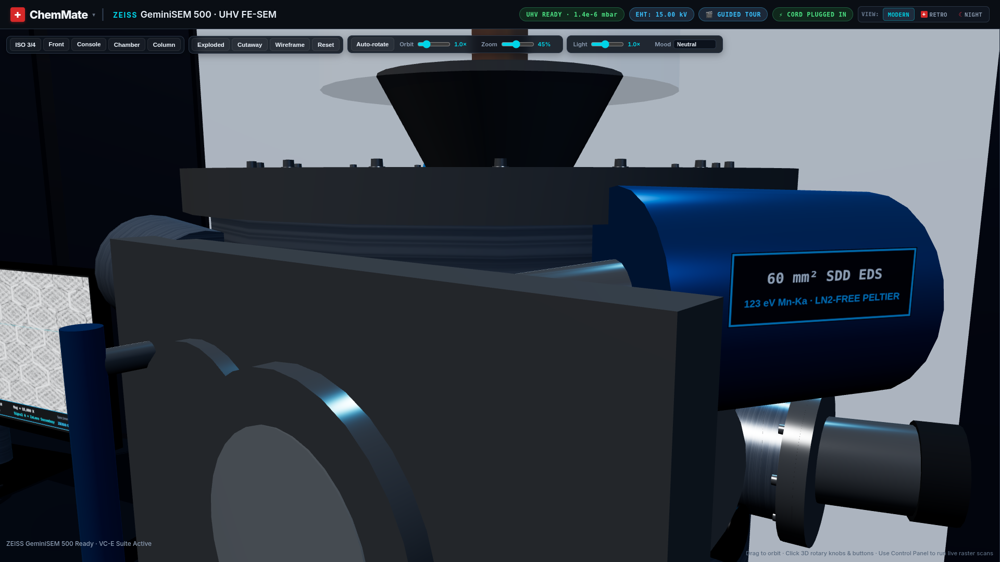

- **Internal Column Cutaway (`Body_InternalColumnOptics`)**: Exposes the upper and lower copper condenser windings (`Body_CoilCondenserUpper`, `Body_CoilCondenserLower`), $+8\text{ kV}$ brass Beam Booster liner (`Body_BeamBoosterTube`), 8-pole scan deflection coils (`Body_ScanDeflectionCoils`), annular `InLens` scintillator ring (`Body_DetectorInLens`), and conical objective polepiece (`Body_ObjectivePolepiece`).
- **45° Optical Relay Mirror (`Body_Mirror_OpticalRelay`) & Class-A `PT100` RTD (`Body_Sensor_PT100`)**: Gold-coated $45^\circ$ optical mirror inside the chamber relays the stage view to the IR CCD chamberscope, while a brass-threaded Class-A `PT100` platinum RTD sensor monitors the water-cooled objective lens jacket ($20.4\,^\circ\text{C} \pm 0.05\,^\circ\text{C}$) via `Body_Wire_SensorBus`.

### 7D. 6-Layer FR-4 Motherboard, MCU, NVMe SSD, Wi-Fi/BLE & Rear I/O Bulkhead (`STAGE7_DATA_COMMS`)

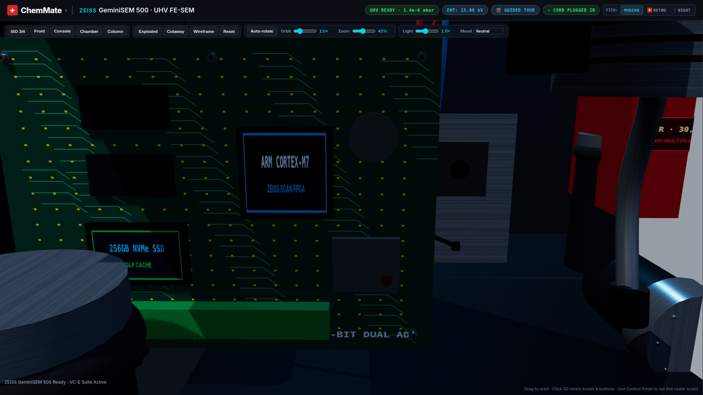

- **6-Layer FR-4 Motherboard (`Body_PCB_Motherboard`)**: Mounted on 6 brass standoffs with M3 hex socket screws, featuring a 176-pin **ARM Cortex-M7 / FPGA Scan Generator (`Body_Part_MCU_ARM`)**, dual **TSOP-54 SDRAM chips (`Body_Part_RAM_Chip`)**, a **256 GB NVMe Solid-State Flash Drive (`Body_Part_SSD_Module`)**, a `CR2032` RTC coin cell, and green Phoenix Contact terminal headers.
- **Wireless & Wired I/O**: Shielded **Wi-Fi 802.11ac / Bluetooth 5.2 BLE radio module (`Body_WiFi_BLE`)** connected via a U.FL micro-coax pigtail (`Body_Wire_WiFiCoax_UFL`) to the rear articulated dipole antenna (`Body_Antenna_WiFi`), alongside rear bulkhead `Body_Port_RS232`, `Body_Port_USB`, removable `Body_USB_Drive`, `Body_Port_RJ45` Gigabit LAN, and forced-convection cooling blower fan (`Body_Fan_CabinetCooling_Blower`).

---

## Stage 8: Dedicated `VC-E` SEM Suite in `lab_viewer` & Narrated 1080p Walkthrough Video

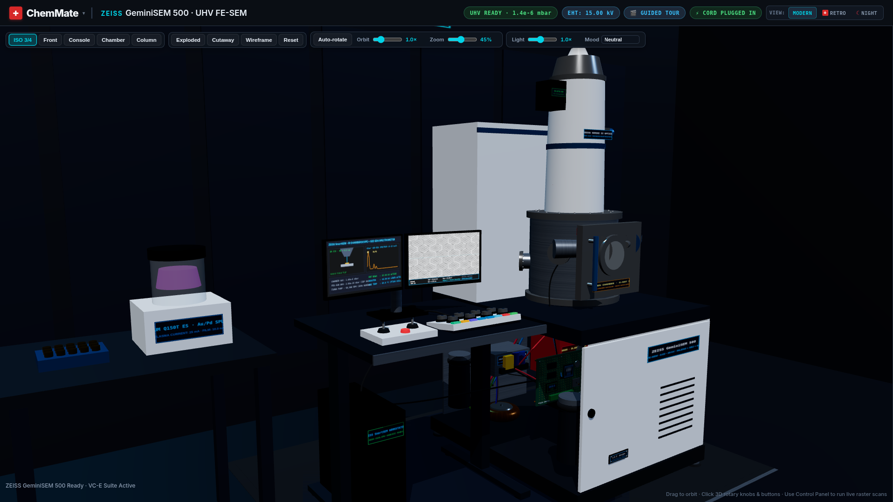

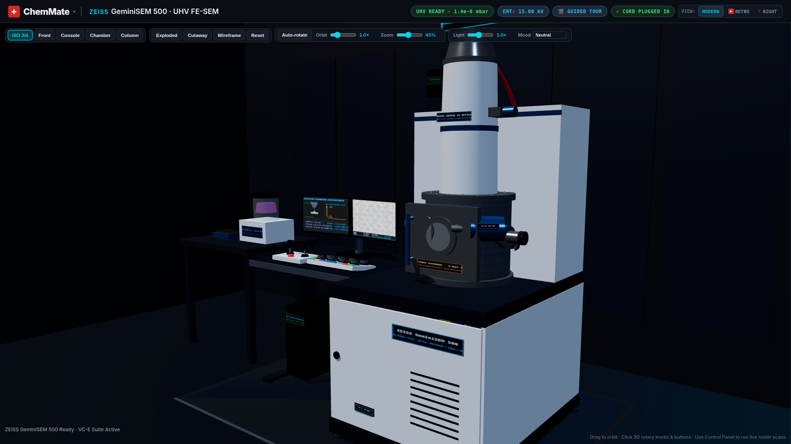

- **Dedicated `VC-E` Suite Room in `lab_viewer`**: Enclosed `61.6 m²` room (`X: 1.0..8.0 m, Z: 9.5..18.3 m`) featuring a seismic inertia slab with neoprene isolation joint, copper RF Faraday wall trim, double PDLC airlock doors (`SEM_SUITE_DOOR`), motorized blackout blinds, dimmable ceiling luminaire (`roomLightGroups.sem`), capacitive `WallControl_SEMSuite` touch panel, and `🔬 SEM Suite` bottom-dock navigation pill.
- **Standalone 1080p H.264/AAC Narrated Walkthrough Video**: [`SEM_GEMINI_Social_Walkthrough.mp4`](SEM_GEMINI_Social_Walkthrough.mp4) (`1920×1080`, 30 FPS, 10 chapters with synchronized voiceover stems `docs/audio/vo_{0..9}.mp3`).

---

## Mandatory 10-Point Pre-Flight Audit Checklist (`CHK-01` – `CHK-10`)

| Check ID | Gate Requirement | Verification Result |
| :--- | :--- | :--- |
| **`CHK-01`** | **Boundary Containment (`DIAG-001`)**: All displays, buttons, knobs, and badges $\le 85\%$ of host face. | **PASS** — Verified in `CAM_FRONT` and `CAM_CONSOLE`. |
| **`CHK-02`** | **Zero Mesh Occlusion & Z-Fighting (`DIAG-002`, `DIAG-003`)**: Positive Z-clearance on `UI_LCD` and decals. | **PASS** — `UI_LCD` seated at $Z = -0.094\text{ u}$ with `Glass_DisplayCover` at $Z = -0.104\text{ u}$. |
| **`CHK-03`** | **Dynamic Canvas LCD Orientation (`DIAG-005`)**: `flipY = false` + upright UVs (`1.0 - uv.getY(i)`). | **PASS** — Both 27" monitors render 100% upright & unmirrored. |
| **`CHK-04`** | **Physical Circuit Continuity (`DIAG-014`)**: `Power_Receptacle_Duplex`, `Power_Plug_NEMA`, `Power_Cord_SJTOW` + hard blackout. | **PASS** — Verified in `STATE_UNPLUGGED` vs. `STATE_STANDBY`. |
| **`CHK-05`** | **Upright Silkscreen Typography (`DIAG-015`, `DIAG-017`)**: All 8 buttons & nameplates have vector silkscreens. | **PASS** — Verified via `fillText(bc.text)` and `CAM_CONSOLE`. |
| **`CHK-06`** | **Ergonomic Control Clearance (`DIAG-018`)**: $\ge 3.5\text{ mm}$ separation between rotary encoders and bezels. | **PASS** — $83\text{ mm}$ center-to-center spacing on ZEISS Dual-Rotary panel. |
| **`CHK-07`** | **Ground Plane Datum (`Y = 0`)**: Leveling feet rest flush at $Y = 0.0\text{ u}$ with zero floor clipping. | **PASS** — `Foot_Leveling_FL..RR` & desk feet rest at $Y = 0.0$. |
| **`CHK-08`** | **Kinematic Exploded Exposure (`DIAG-020`)**: $\ge 100\text{ mm}$ separation exposing internal pumps, HV tank & PCB. | **PASS** — Verified in `CAM_EXPLODED` and `STAGE7A–7D`. |
| **`CHK-09`** | **Single-Sided Ceiling & Room Framing (`DIAG-022`, `DIAG-026`)**: Downward-facing ceiling at $Y = 30.0\text{ u}$; zero top-view occlusion. | **PASS** — Verified in `CAM_TOP`. |
| **`CHK-10`** | **Zero Console Exceptions & 100% Unit Test Pass**: `Total exceptions: 0` in CDP; `12/12` Python tests pass. | **PASS** — Verified via `test.sh`, `oga_validator.mjs`, and CDP audit. |
