# Master Planning Schedule & Execution Sprints (Sprints 1–10)

> **Phase Status:** Planning Only — no source files modified.
> **Baseline Scope:** 3 Locked Reference Twins (`centrifuge_twin`, `disintegration_tester_twin`, `spectrophotometer_twin`) · 15 Existing Twins Scheduled for Remediation (including 1 Archive + New OEM Replacement for `vortex_mixer_twin`) · 2 Dedicated Cold-Storage Builds (`lab_refrigerator_twin`, `lab_freezer_twin`) · Waves A–E New Machines & Essential Lab Equipment.

---

## 1. Execution Dependency & Critical Path Graph

Because new machine builds live in isolated directories (`lab_refrigerator_twin/`, `uhplc_twin/`, etc.), **Cold Storage & New Equipment Waves can run in a parallel fast-track lane** alongside the existing-fleet remediation sprints without file-ownership conflicts, provided shared `lab_viewer/engine/LabDockManager.js` updates are serialized at sprint merge boundaries.

```mermaid
flowchart LR
    T0["Tier 0 Locked Refs: centrifuge, ERWEKA ZT 322, UV-1900i"] --> S1["Sprint 1 (Tier 1): 708-DS, Ultrasonic, Muffle Furnace"]
    S1 --> S2["Sprint 2 (Tier 2): Balance & FTIR Interior Overhauls"]
    S2 --> S3["Sprint 3 (Tier 3): Vacuum Pump, Hotplate, Rotovap"]
    S3 --> S4["Sprint 4 (Tier 4): Glove Box, FreeZone, Parr Reactor"]
    S4 --> ARC["Archive Gate: Copy vortex_mixer_twin to .master/04_ARCHIVE/vortex_mixer_genie2_v1"]
    ARC --> S5["Sprint 5 (Tier 5): New Vortex Model, pH Meter, Karl Fischer"]
    S5 --> S6["Sprint 6 (Tier 6): SEM Flagship Ground-Up Rebuild"]

    T0 -.->|"Parallel Cold-Chain Track"| COLD["Sprint 7 (Wave A Cold Storage): Lab Refrigerator & ULT/Enzyme Freezer"]
    COLD --> W_A2["Sprint 7B (Wave A Core): Drying Oven, Milli-Q IQ 7003, Incubator Shaker"]
    W_A2 --> W_B["Sprint 8 (Wave B): UHPLC, GC-MS, Orbitrap LC-MS, Biotage Flash"]
    W_B --> W_C["Sprint 9 (Wave C): NMR, XRD, DSC/TGA, Polarimeter, Mel-Temp, Bomb Cal, Titrator, Potentiostat, Geiger, Gas Piston, Contact Angle"]
    W_C --> W_DE["Sprint 10 (Waves D & E): Synthesis/Flow, Pharma QC, Pipettes, Washer, Safety Cabinets, Lab Viewer Final Audit"]
    S6 --> W_DE
```

---

## 2. Fleet Remediation Schedule (Sprints 1–6)

Each sprint aligns strictly with the Remediation Tiers in [`README.md`](file:///Users/Samuel/AGapps/Twins/update/README.md) and [`01_EXISTING_18_MACHINES_AUDIT_NOTES.md`](file:///Users/Samuel/AGapps/Twins/update/01_EXISTING_18_MACHINES_AUDIT_NOTES.md).

### Sprint 1 — Tier 1: Almost-There Polish & Gate 5 Completion (Quickest Wins)
*Goal: Elevate the 3 highest-scoring non-locked machines from 20/25 OGA gates to full 25/25 accredited status.*

| Parallel Track | Target Machine | Primary Scope | Lead Subagents (from 14-Agent Roster) |
| :--- | :--- | :--- | :--- |
| **Track 1A** | [`dissolution_tester_twin/`](file:///Users/Samuel/AGapps/Twins/dissolution_tester_twin) | Minor lid/cannula seat polish + Gate 5 motor/probe/optical/Wi-Fi tags (`INT-02..04`) + Guided Tour & 1080p MP4 (`PRES-01..02`). | `twin_internal_mechanics_builder`, `twin_sensor_data_engineer`, `twin_narrator_video_director`, `twin_visual_qa_auditor` |
| **Track 1B** | [`ultrasonic_cleaner_twin/`](file:///Users/Samuel/AGapps/Twins/ultrasonic_cleaner_twin) | Preserve exterior; rebuild internal PZT-4 Langevin transducers, 40 kHz HF driver PCB, tank heater/PT100, drain actuator (`INT-02..04`) + Tour & MP4. | `twin_internal_mechanics_builder`, `twin_power_circuit_engineer`, `twin_sensor_data_engineer`, `twin_narrator_video_director` |
| **Track 1C** | [`muffle_furnace_twin/`](file:///Users/Samuel/AGapps/Twins/muffle_furnace_twin) | Refine counterbalanced lift-door linkage, stepped ceramic refractory throat, Type-S TC + exhaust blower (`INT-02..04`) + Tour & MP4. | `twin_chassis_builder`, `twin_internal_mechanics_builder`, `twin_controls_ergonomics_engineer`, `twin_narrator_video_director` |

---

### Sprint 2 — Tier 2: Approved Exteriors, Interior-Only Overhauls
*Goal: Keep the externally praised exteriors intact while building authentic, deep OEM internal anatomy, PSUs, circuit continuity, and Gate 5 compliance.*

| Parallel Track | Target Machine | Hard Constraint | Lead Subagents |
| :--- | :--- | :--- | :--- |
| **Track 2A** | [`balance_twin/`](file:///Users/Samuel/AGapps/Twins/balance_twin) *(6/25 -> 25/25)* | **Preserve external housing, draft shield & pan.** Refactor interior to build MonoBloc EMFR flexure cell, NdFeB voice coil, internal cal weights (`Motor_Lift`), `PCB_Motherboard`, linear `Assembly_PowerSupply`, `Power_Receptacle_Duplex` continuity, `createDecalQuad`, Tour & MP4. | `twin_internal_mechanics_builder`, `twin_power_circuit_engineer`, `twin_sensor_data_engineer`, `twin_controller_logic_engineer` |
| **Track 2B** | [`ftir_twin/`](file:///Users/Samuel/AGapps/Twins/ftir_twin) *(12/25 -> 25/25)* | **Preserve external housing & Diamond ATR stage.** Complete internal Michelson interferometer (KBr beamsplitter, corner-cube voice coil `Motor_Drive`, HeNe laser `Mirror_OpticalRelay`), SiC Globar source, DTGS optics, PSU, continuity, `createDecalQuad`, Tour & MP4. | `twin_internal_mechanics_builder`, `twin_power_circuit_engineer`, `twin_display_silkscreen_engineer`, `twin_narrator_video_director` |

---

### Sprint 3 — Tier 3: Exterior Industrial Design + Full Internal Mechanical/Power Overhauls
*Goal: Eliminate primitive box aesthetics, fix geometric port collisions, upgrade PBR materials, and install genuine power/pump/motor internals.*

| Parallel Track | Target Machine | Primary Engineering Deliverables | Lead Subagents |
| :--- | :--- | :--- | :--- |
| **Track 3A** | [`vacuum_pump_twin/`](file:///Users/Samuel/AGapps/Twins/vacuum_pump_twin) *(9/25 -> 25/25)* | Fix front-fascia port collision (`Port_Vacuum_Inlet_KF25` at `Z = -0.84` vs `Plate_ConsoleFace` at `Z = -0.80`); sculpt chamfered die-cast housing + elastomer bellows; add genuine split eccentric-crank dual-stage PTFE diaphragm pump heads (`Motor_Harmonic`, `Motor_Drive`), check valves, PSU, continuity, Tour & MP4. | `twin_chassis_builder`, `twin_internal_mechanics_builder`, `twin_power_circuit_engineer`, `twin_visual_qa_auditor` |
| **Track 3B** | [`hotplate_twin/`](file:///Users/Samuel/AGapps/Twins/hotplate_twin) *(9/25 -> 25/25)* | Upgrade PBR die-cast chassis + white/black glass-ceramic top + silicone control bezel; install internal cast-Al heating element, AlNiCo rotating drive magnet (`Motor_Harmonic`), PT1000 rod assembly, optical tach, triac/SSR `Assembly_PowerSupply`, continuity, Tour & MP4. | `twin_chassis_builder`, `twin_internal_mechanics_builder`, `twin_power_circuit_engineer`, `twin_controls_ergonomics_engineer` |
| **Track 3C** | [`rotovap_twin/`](file:///Users/Samuel/AGapps/Twins/rotovap_twin) *(14/25 -> 25/25)* | Rebuild cantilevered elevator tower, diagonal/vertical borosilicate Liebig-spiral condenser (`Glass_*`), PTFE rotary vapor duct, water/oil bath with internal ring heater, brushless rotation drive (`Motor_Harmonic`), stepper lift (`Motor_Lift`), PSU & continuity, Tour & MP4. | `twin_chassis_builder`, `twin_labware_fluid_specialist`, `twin_internal_mechanics_builder`, `twin_power_circuit_engineer` |

---

### Sprint 4 — Tier 4: Severe Structural, Containment & Manifold Rebuilds
*Goal: Eliminate all floating parts, establish solid mechanical mounting paths, and build high-pressure / cryogenic / inert-atmosphere internal assemblies.*

| Parallel Track | Target Machine | Primary Engineering Deliverables | Lead Subagents |
| :--- | :--- | :--- | :--- |
| **Track 4A** | [`glove_box_twin/`](file:///Users/Samuel/AGapps/Twins/glove_box_twin) *(13/25 -> 25/25)* | Weld/ground all 5 disconnected assemblies (pressure gauge, needle/ball valves, rear O2/H2O purifier column & blower, spline-routed purge hose, articulated HMI console pedestal); full steel stand legs at `Y = 0.0`, glove port bellows, pre-chamber inner/outer doors, PSU & Tour. | `twin_chassis_builder`, `twin_internal_mechanics_builder`, `twin_sensor_data_engineer`, `twin_visual_qa_auditor` |
| **Track 4B** | [`freeze_dryer_twin/`](file:///Users/Samuel/AGapps/Twins/freeze_dryer_twin) *(14/25 -> 25/25)* | Upgrade Labconco FreeZone 4.5L acrylic drying manifold + neoprene Labconco flasks, brushed stainless ice condenser coil at `-84 °C`, dual-stage cascade compressors (`Motor_Harmonic`, `Motor_Drive`), brazed heat exchanger, `PCB_Motherboard`, Pirani vacuum probe, Tour & MP4. | `twin_chassis_builder`, `twin_labware_fluid_specialist`, `twin_internal_mechanics_builder`, `twin_power_circuit_engineer` |
| **Track 4C** | [`high_pressure_reactor_twin/`](file:///Users/Samuel/AGapps/Twins/high_pressure_reactor_twin) *(10/25 -> 25/25)* | Authentic Parr 4560 floor/bench A-frame stand with split-ring clamp collar + 8 hex cap bolts, magnetic stirrer drive coupling (`Motor_Harmonic`) with internal cooling coil + impeller, Bourdon gauge + Inconel burst disc + thermocouple well, separated Parr 4848 PID controller box with full internals & continuity. | `twin_chassis_builder`, `twin_internal_mechanics_builder`, `twin_power_circuit_engineer`, `twin_controller_logic_engineer` |

---

### Sprint 5 — Tier 5: Archive Vortex V1 + Complete Benchtop Ground-Up Rebuilds
*Goal: Preserve legacy Vortex Mixer V1 intact before building a different OEM vortex mixer from scratch, alongside full ground-up rebuilds of the Benchtop pH Meter and Volumetric Karl Fischer Titrator.*

#### Mandatory Pre-Sprint 5 Archive Step
Before touching a single byte in `vortex_mixer_twin/`:
1. Execute intact snapshot archive (during Sprint 5 execution):
   - Preserve exact legacy directory cleanly under `.master/04_ARCHIVE/vortex_mixer_genie2_v1/` (including viewer, controller, tests, and docs).
   - Verify archive read/syntax integrity (`git status` + `verify_twin.sh` on archived snapshot if needed) and verify any `vortex_mixer` references in `lab_viewer/` remain compatible during transition.
2. Only after snapshot verification succeeds does Sprint 5 Track 5A build the brand-new OEM replacement inside `vortex_mixer_twin/` (or version-switched cleanly in `LabDockManager.js`).

| Parallel Track | Target Machine | Primary Engineering Deliverables | Lead Subagents |
| :--- | :--- | :--- | :--- |
| **Track 5A** | [`vortex_mixer_twin/`](file:///Users/Samuel/AGapps/Twins/vortex_mixer_twin) *(Archive V1 -> Build New OEM)* | Archive Genie 2 V1 to `.master/04_ARCHIVE/vortex_mixer_genie2_v1/`; build **IKA Vortex 3 Digital / Thermo LP Low-Profile Digital Vortex Mixer** from ground up with sculpted zinc die-cast body, silicone orbital cup/microplate pad, capacitive LED touch console (`UI_LCD` + `Btn_*`), brushless orbital counterbalance cam (`Motor_Harmonic`), PSU & continuity, Tour & MP4. | All 14 Subagents (`twin_spec_researcher` first for new OEM BOM/dims) |
| **Track 5B** | [`ph_meter_twin/`](file:///Users/Samuel/AGapps/Twins/ph_meter_twin) *(20/25 lint, Visual Rebuild)* | Full ground-up redesign modeled on **Mettler Toledo SevenExcellence S470**: 7" color capacitive glass front bezel (`UI_LCD`), chamfered housing, articulated spring-balanced uPlace electrode arm, multi-parameter InLab Expert Pro-ISM glass electrode with BNC/DIN cables into amber/blue/pink NIST buffer flasks + magnetic stir base, internal 24-bit high-impedance electrometer PCB + PSU + continuity + Tour & MP4. | All 14 Subagents |
| **Track 5C** | [`karl_fischer_twin/`](file:///Users/Samuel/AGapps/Twins/karl_fischer_twin) *(14/25 -> 25/25)* | Full ground-up rebuild modeled on **Metrohm 901 Titrando + 800 Dosino + 803 Ti Stand**: dedicated motorized burette dosing top with glass cylinder & 4-port distributor, sealed 5-neck borosilicate KF titration vessel with septum injection port, double-Pt indicator electrode, molecular sieve drying tubes (`CaCl2`/zeolite), reagent reservoir bottles, membrane/capacitive controller + full Stepper/ADC/PSU internals + Tour & MP4. | All 14 Subagents |

---

### Sprint 6 — Tier 6: Flagship Multi-Assembly Ground-Up Build (`sem_twin`)
*Goal: Transform the 464-line sketch in `sem_twin` (6/25 OGA gates, missing `sfx.js`, missing `research/`) into an iconic laboratory showpiece.*

| Parallel Track | Target Machine | Primary Engineering Deliverables | Lead Subagents |
| :--- | :--- | :--- | :--- |
| **Track 6A (Stage 1)** | [`sem_twin/`](file:///Users/Samuel/AGapps/Twins/sem_twin) *(Research & Controller)* | Author `research/` OEM spec + BOM for **ZEISS GeminiSEM / Thermo Apreo 2 Class** (`1650 mm` floor-standing column + pneumatic isolation console + dual 27" monitors + control joystick/knobs desk); write `sem_controller.py` + `test_controller.py` (HV/beam interlocks, TMP vacuum pumpdown curve, magnification/WD/stigmator physics). | `twin_spec_researcher`, `twin_controller_logic_engineer` |
| **Track 6B (Stage 2)** | [`sem_twin/`](file:///Users/Samuel/AGapps/Twins/sem_twin) *(3D Column, Optics & Vacuum)* | Multi-assembly CAD: passive/active air-spring isolation table (`Y = 0.0`), recessed draw-out **5-axis motorized eucentric specimen chamber & stub carousel**, **electron optical column** (Schottky FEG gun, 2 electromagnetic condenser lenses, objective conical polepiece, aperture strip micrometer knobs, Everhart-Thornley SE + annular BSE detectors), rear **turbomolecular + rotary scroll pump** bay (`Motor_Harmonic`, `Motor_Drive`, Pirani/Penning gauges). | `twin_chassis_builder`, `twin_internal_mechanics_builder`, `twin_sensor_data_engineer` |
| **Track 6C (Stage 3)** | [`sem_twin/`](file:///Users/Samuel/AGapps/Twins/sem_twin) *(HV PSU, Dual Display, Audio & QA)* | Dual articulated monitor arm showing real-time procedural SEM micrographs (gold nanoparticles, pollen grain, fracture dimples, integrated circuit die reacting dynamically to kV, beam current, focus, stigmator & brightness/contrast), HV 30 kV tank (`Assembly_PowerSupply`), rotary control panel, `sfx.js` (TMP spin-up, relay clack, rotary scroll hum, air-vent hiss), `TOUR_CHAPTERS` + 1080p MP4, dock at `(5.0, 0.0, -1.8)`. | `twin_power_circuit_engineer`, `twin_display_silkscreen_engineer`, `twin_audio_sfx_synthesizer`, `twin_web_ui_architect`, `twin_narrator_video_director`, `twin_visual_qa_auditor` |

---

## 3. New Machines & Essential Lab Equipment Schedule (Sprints 7–10)

### Sprint 7 — Cold Storage & Wave A Core Utility Suite
*Can begin immediately on a parallel track alongside Sprints 1–2 if approved by user.*
- **Track 7A (Cold Storage Priority):** [`lab_refrigerator_twin/`](file:///Users/Samuel/AGapps/Twins/update/02_COLD_STORAGE_FREEZER_AND_REFRIGERATOR_PLAN.md) (+2 °C to +8 °C Glass-Door) & `lab_freezer_twin/` (-80 °C ULT + -20 °C Enzyme Mode) — full 14-subagent builds + Zone 3 `LabDockManager.js` floor docking.
- **Track 7B (Core Utilities):** `drying_oven_twin` (Binder FD/VD 115), `water_purification_twin` (Milli-Q IQ 7003 + Q-POD), `incubator_shaker_twin` (Eppendorf Innova 42).

### Sprint 8 — Wave B: Chromatography & Mass Spectrometry Suite
- `uhplc_twin` (Agilent 1290 Infinity II 4-stack + DAD)
- `gc_ms_twin` (Agilent 8890/5977C/7693A + capillary oven + turbomolecular quad chamber)
- `lc_ms_orbitrap_twin` (Thermo Orbitrap Exploris 240 H-ESI + spindle analyzer)
- `flash_chromatography_twin` (Biotage Selekt + XYZ fraction collector)

### Sprint 9 — Wave C: Spectroscopy, Structural, Thermal & Curriculum Suite
- **Phase 9A (Core Physical/Structural):** `nmr_twin` (Bruker Avance Neo 400 + SampleJet), `xrd_twin` (Bruker D8 Discover), `dsc_tga_twin` (TA Discovery 2500/5500).
- **Phase 9B (Bench Analytical & ChemMate Curriculum):** `polarimeter_twin` (Autopol VI), `mel_temp_twin` (Mettler MP90), `calorimeter_twin` (Parr 6200 Bomb), `auto_titrator_twin` (Mettler T9), `potentiostat_twin` (Gamry 1010E), `radiation_detector_twin` (Ludlum + Lead Castle), `gas_laws_piston_twin`, `contact_angle_twin`.

### Sprint 10 — Waves D & E: Synthesis, Pharma QC, Lab Equipment & Facility Finale
- **Synthesis & QC:** `microwave_synthesizer_twin`, `flow_reactor_twin`, `jacketed_reactor_twin` + Huber Unistat 405, `schlenk_line_twin`, `tablet_combo_tester_twin` (Sotax AT50 / ERWEKA TAR 220).
- **Essential Equipment & Infrastructure:** `pipette_station_twin` (P2–P1000 carousel + filter tips), `desiccator_cabinet_twin`, `glassware_washer_twin` (Miele PG 8583), interactive NFPA 30 flammable/corrosive cabinets, ANSI Z358.1 emergency shower/eyewash, interactive Zone 1/2 fume hood sashes, overhead utility carriers.
- **Full Facility QA Gate:** Run [`scripts/audit_lab.mjs`](file:///Users/Samuel/AGapps/Twins/scripts/audit_lab.mjs), [`scripts/test_mobile_lab.mjs`](file:///Users/Samuel/AGapps/Twins/scripts/test_mobile_lab.mjs), and [`scripts/capture_showcase.mjs`](file:///Users/Samuel/AGapps/Twins/scripts/capture_showcase.mjs) across the complete docked lab.

---

## 4. Mandatory Definition of Done (Per-Machine Signoff Gate)

No machine in Sprints 1–10 may be marked **Complete** until **100%** of these checks pass after its final edit:

1. **Automated Mechanical Linter:** `node scripts/oga_validator.mjs <twin_dir>` outputs **25 / 25 PASSED** (Code 0).
2. **Script & Syntax Verification:** `bash scripts/verify_twin.sh <twin_dir>` passes directory, ES module syntax (`vm.SourceTextModule`), cache-busting `?v=`, and `makeSREdesignsBadge` checks.
3. **Python Dual-Truth Controller Suite:** `python3 <twin_dir>/software/controller/test_controller.py` passes **100%** of state-transition, safety-interlock, and power-continuity tests.
4. **6-Angle + Stage-7 CDP Visual Audit:** Headless Chrome screenshots of `CAM_ISO`, `CAM_FRONT`, `CAM_SIDE`, `CAM_TOP`, `CAM_EXPLODED`, `STATE_ACTIVE`, plus Stage-7 internal close-ups (`PWR`, `MOTORS`, `SENSORS`, `COMMS`) generated and **visually inspected via `view_file`** with **zero** browser console errors (`Total exceptions: 0`).
5. **10-Point Preflight & Troubleshooting Verification:** `CHK-01` through `CHK-10` and `DIAG-001..026` verified clear (zero floating geometry, upright decals/LCD, $Y = 0$ datum, continuity power gating).
6. **Narrated Walkthrough Delivery (Stage 8):** In-app `#btnGuidedTour` (`TOUR_CHAPTERS`) + standalone 1080p `.mp4` generated cleanly via [`scripts/build_twin_video.mjs`](file:///Users/Samuel/AGapps/Twins/scripts/build_twin_video.mjs).
7. **Facility Integration:** Docked at conflict-free coordinates in [`lab_viewer/engine/LabDockManager.js`](file:///Users/Samuel/AGapps/Twins/lab_viewer/engine/LabDockManager.js) and verified visually inside `lab_viewer`.
